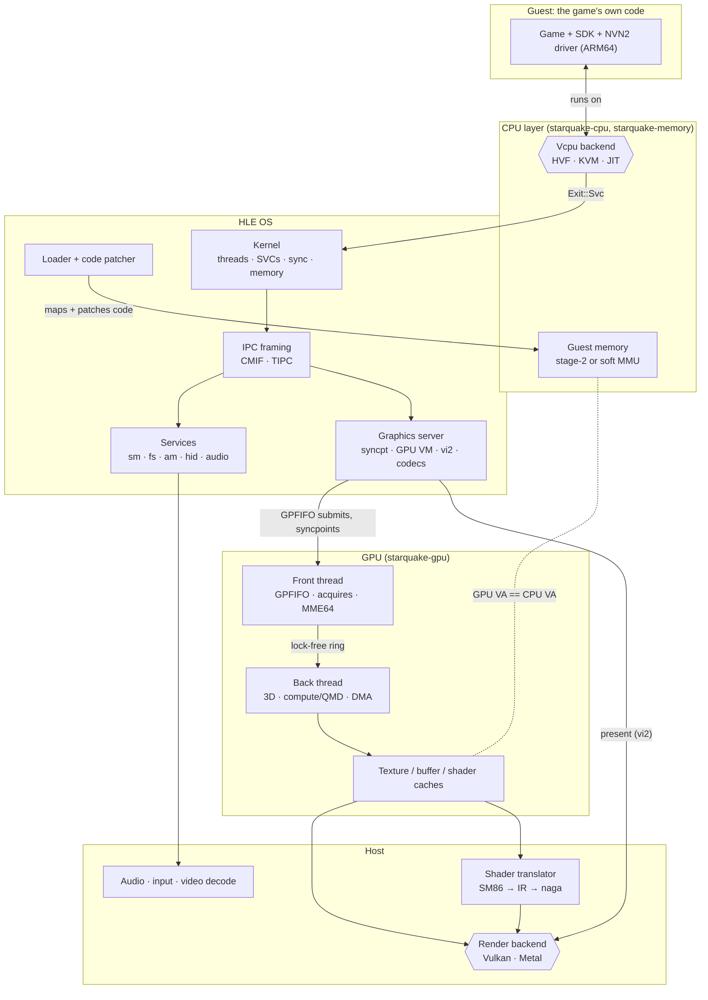
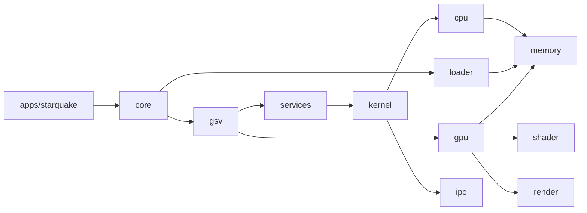

# Architecture (proposal)

Status: proposal, 2026-11-11. Nothing here is implemented yet beyond the crate skeleton, the
`memory`/`cpu` traits, and `tools/hvprobe`. Background: `switch2-eden-diff-scoping.md`.

## The big picture

A Switch 2 game is an ARM64 program that talks to an OS (Horizon) through system calls, and to a
GPU (Ampere-class) through command buffers. Starquake runs the program's code directly where it
can (Hypervisor.framework, KVM) or translates it (x86-64 JIT), re-implements the OS in Rust (HLE),
and replays the GPU's work on the host GPU through Vulkan or Metal.

## How a frame flows

1. **Loading.** `loader` parses NSO/NPDM, maps code into guest memory, and patches every
   `mrs xN, cntpct_el0` into a branch to a backend stub (0.9 ns per read instead of 760 ns on
   HVF). It hands the kernel a process description: address-space layout, core mask (0-5),
   PAuth keys, 12 GB memory layout.
2. **Running guest code.** Each of the six application cores is a host thread that owns one
   vCPU and loops: `vcpu.run()` → handle the `Exit` → resume. Guest threads are scheduled onto
   these vCPUs by the HLE kernel; context switches swap `GuestRegs` and PAuth keys.
3. **System calls.** `svc #n` exits to the kernel on the same host thread (no cross-thread hop,
   ~0.76 µs round trip on HVF). `SendSyncRequest` parses the IPC buffer with `ipc` and calls the
   target session's handler in `services` or `gsv`.
4. **Graphics.** NVN2 writes command buffers into guest memory and submits GPFIFO entries
   through `gsv`/`nvsrv`. The GPU front thread parses them, honours semaphore acquires (the CPU
   gates each command buffer this way), runs MME64 macros, and pushes engine methods into a
   ring. The back thread applies them to engine state and records draws and dispatches.
5. **Shaders and resources.** Draws pull shaders through the shader cache (SM86 → IR → `naga`
   → SPIR-V/MSL) and resources through the texture and buffer caches (GOB deswizzle, ASTC
   passthrough on Metal, transcode on Vulkan where needed).
6. **Present.** vi2 present (`gsv` 229) hands the frame to the render backend, signals the
   frame's fence, and paces the game at 60 Hz.

## Threads

| Thread | Count | Does |
|---|---|---|
| vCPU | 6 | Runs guest code; handles SVCs and IPC inline |
| GPU front | 1 | Parses command streams, runs macros, waits on acquires |
| GPU back | 1 | Engine state, draws/dispatches, records into the render backend |
| Render submit/present | 1 | Submits host command buffers, presents, owns the swapchain |
| Shader compile workers | N | Pipeline compilation off the hot path |
| Audio, input, video decode | 1 each | Host I/O |
| Timers | 1 | Vsync events (vi2 31/32), syncpoint polling, kernel timeouts |

## Crates and dependency direction

Rules: no cycles, no reaching around a layer, frontends only see `core`. `ipc` works on byte
slices and depends on no other workspace crate; its caller copies the buffer out of guest memory.
Backends are selected by `cfg` (target OS/arch) plus Cargo features, never by runtime checks
scattered through code.

## Platform matrix

| | macOS arm64 | Linux arm64 | Linux x86-64 (Steam Deck class) |
|---|---|---|---|
| CPU backend | HVF (measured, works) | KVM (planned) | JIT (planned; must emulate PAuth, LSE, RCpc) |
| Counter reads | Patched stub | Patched stub | JIT intrinsic |
| Render backend | Metal (Vulkan via MoltenVK for bring-up) | Vulkan | Vulkan |
| ASTC | Native | Depends on GPU | Transcode (AMD) |
| Memory | Unified: alias guest buffers | Discrete or unified | Unified (Deck APU) |

## What makes it agent-friendly

- **One gate** (`cargo xtask ci`), the same locally and in CI, under ~2 s today.
- **Traits at the seams** (`Vcpu`, `GuestMemory`, service handlers, render backend), each with an
  in-memory test implementation, so most logic is testable without a hypervisor or GPU.
- **Golden traces, planned:** record SVC/IPC/GPU-method traces from homebrew runs and diff
  them in tests, so behaviour changes show up as reviewable diffs.
- **Offline harnesses, planned:** recorded MME calls (replay and compare), shader fixtures
  checked against `nvdisasm`, `naga` validation of every translated shader.
- **Auto-stub plus trace** for unknown IPC commands and SVCs, the same tool that let Eden-NX2
  boot titles quickly.
