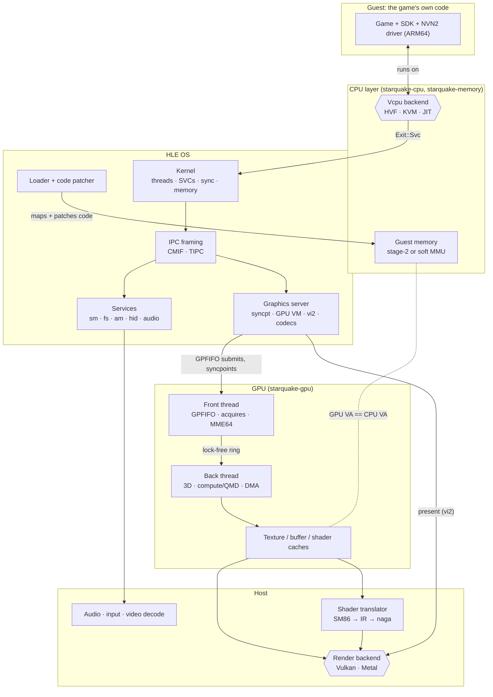
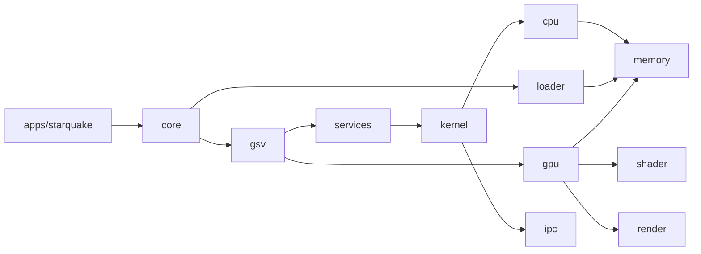

# Architecture (proposal)

Status: proposal, 2026-11-11. What runs today is the walking skeleton described at the end of
this file; the rest is the design it grows into. Background: `switch2-eden-diff-scoping.md`.

## The big picture

A Switch 2 game is an ARM64 program that talks to an OS (Horizon) through system calls, and to a
GPU (Ampere-class) through command buffers. Starquake runs the program's code directly where it
can (Hypervisor.framework, KVM) or translates it (x86-64 JIT), re-implements the OS in Rust (HLE),
and replays the GPU's work on the host GPU through Vulkan or Metal.



## How a frame flows

1. **Loading.** `loader` parses NSO/NPDM, maps code into guest memory, and patches every
   `mrs xN, cntpct_el0` into a branch to a backend stub (0.9 ns per read instead of 760 ns on
   HVF). It hands the kernel a process description: address-space layout, core mask (0-5),
   PAuth keys, 12 GB memory layout.
2. **Running guest code.** Each of the six application cores is a host thread that owns one
   vCPU and loops: `vcpu.run()` → handle the `Exit` → resume. Guest threads are scheduled onto
   these vCPUs by the HLE kernel; context switches swap `GuestRegs` and PAuth keys.
3. **System calls.** `svc #n` exits to the kernel on the same host thread (no cross-thread hop,
   ~0.76 µs round trip on HVF). `SendSyncRequest` parses the IPC buffer with `ipc` and calls the
   target session's handler in `services` or `gsv`.
4. **Graphics.** NVN2 writes command buffers into guest memory and submits GPFIFO entries
   through `gsv`/`nvsrv`. The GPU front thread parses them, honours semaphore acquires (the CPU
   gates each command buffer this way), runs MME64 macros, and pushes engine methods into a
   ring. The back thread applies them to engine state and records draws and dispatches.
5. **Shaders and resources.** Draws pull shaders through the shader cache (SM86 → IR → `naga`
   → SPIR-V/MSL) and resources through the texture and buffer caches (GOB deswizzle, ASTC
   passthrough on Metal, transcode on Vulkan where needed).
6. **Present.** vi2 present (`gsv` 229) hands the frame to the render backend, signals the
   frame's fence, and paces the game at 60 Hz.

## Threads

| Thread | Count | Does |
|---|---|---|
| vCPU | 6 | Runs guest code; handles SVCs and IPC inline |
| GPU front | 1 | Parses command streams, runs macros, waits on acquires |
| GPU back | 1 | Engine state, draws/dispatches, records into the render backend |
| Render submit/present | 1 | Submits host command buffers, presents, owns the swapchain |
| Shader compile workers | N | Pipeline compilation off the hot path |
| Audio, input, video decode | 1 each | Host I/O |
| Timers | 1 | Vsync events (vi2 31/32), syncpoint polling, kernel timeouts |

## Crates and dependency direction



Rules: no cycles, no reaching around a layer, frontends only see `core`. `ipc` works on byte
slices and depends on no other workspace crate; its caller copies the buffer out of guest memory.
Backends are selected by `cfg` (target OS/arch) plus Cargo features, never by runtime checks
scattered through code.

## Platform matrix

| | macOS arm64 | Linux arm64 | Linux x86-64 (Steam Deck class) |
|---|---|---|---|
| CPU backend | HVF (measured, works) | KVM (planned) | JIT (planned; must emulate PAuth, LSE, RCpc) |
| Counter reads | Patched stub | Patched stub | JIT intrinsic |
| Render backend | Metal (Vulkan via MoltenVK for bring-up) | Vulkan | Vulkan |
| ASTC | Native | Depends on GPU | Transcode (AMD) |
| Memory | Unified: alias guest buffers | Discrete or unified | Unified (Deck APU) |

## What makes it agent-friendly

- **One gate** (`cargo xtask ci`), the same locally and in CI, under ~2 s today.
- **Traits at the seams** (`Vcpu`, `GuestMemory`, service handlers, render backend), each with an
  in-memory test implementation, so most logic is testable without a hypervisor or GPU.
- **Golden traces, planned:** record SVC/IPC/GPU-method traces from homebrew runs and diff
  them in tests, so behaviour changes show up as reviewable diffs.
- **Offline harnesses, planned:** recorded MME calls (replay and compare), shader fixtures
  checked against `nvdisasm`, `naga` validation of every translated shader.
- **Auto-stub plus trace** for unknown IPC commands and SVCs, the same tool that let Eden-NX2
  boot titles quickly.

## What runs today: the walking skeleton

The thinnest end-to-end run (`roadmap.md`, "Route to milestone 1"), so that the pieces are
proven to fit before more are built. On macOS on Apple Silicon:

```sh
cargo run -p starquake-testkit --example guest_programs -- <folder>   # writes four test NROs
cargo run -p starquake -- run <folder>/hello.nro --until timeout=10s --artifacts <folder>/out
```

`starquake-core`'s `System` parses the NRO with the loader, creates the process's memory with
the kernel (the code at Horizon's address for it and a stack in the stack region; text
read-execute, rodata read-only, the rest read-write), rewrites its counter reads with the
loader's patcher, creates the process with the kernel's process creation (which starts its main
thread, with a thread-local page, and tells the scheduler the one core runs it), and runs that
thread on one vCPU. What the kernel's
address space maps reaches guest code through stage-1 tables, a page at a time as the guest
first touches it. Every `svc` goes through the kernel's dispatcher and is recorded in the event
stream; the memory calls (`SetHeapSize`, `SetMemoryPermission`, `SetMemoryAttribute`,
`QueryMemory`, and `GetInfo`'s memory ids) are real, and so is IPC: `ConnectToNamedPort`,
`SendSyncRequest` and closing a session reach the services `crates/core/src/hle.rs` registers
(`sm:` on its port, and `set:sys` behind it), whose handlers run without the kernel lock. The
homebrew fixture (`tests/homebrew/hello/hello.nro`) runs to `ExitProcess` with exit code 0, its
trace matching the reference emulator's line for line. The run ends when the guest calls
`ExitProcess`, crashes, or reaches the timeout, and the artifacts folder gets `summary.json`,
`trace.txt`, `events.bin`, `guest_log.txt`, and `crash.json` and `crash.txt` after a crash
(`guest_log.txt` is an addition to the spec's table: an event keeps a log line's length and
hash, not its text). The
exit codes are the headless contract's (`specs/observability.md`). On other hosts the same
command reports that no CPU backend is available (exit code 2).

The tests are in `crates/core`: `src/machine/tests.rs` drives the loop with a scripted vCPU on
every host, and `tests/skeleton.rs` runs the testkit's guest programs natively.

It is deliberately thinner than the specs. Each provisional part is marked `PROVISIONAL` where
it lives, with what replaces it:

| Provisional part | Where | Replaced by |
|---|---|---|
| The process's code and stack are placed by the loader: the code at a fixed address with no relocation, one stack of a fixed size, the 4 GiB memory arrangement for every program. The process is described by Eden's defaults for a program with no NPDM (`ProcessDescription::homebrew`), built for Switch 1 | `crates/core/src/image.rs`, `crates/core/src/machine.rs`, `crates/core/src/clock.rs` | Wiring the loader's NPDM into process creation (#33) |
| Backing is handed out a page at a time from the start of one small RAM region (16 MiB) and never returned, far less than the kernel lets a process reserve; host access to guest memory ignores permissions | `crates/core/src/space.rs`, `crates/cpu/src/hvf.rs` | The backing pools of the execution model, sized as the kernel's accounting says; permission checks on system-call buffers |
| One guest thread on one core: the loop runs only the main thread, and a call that leaves it waiting or ends it while its process has other threads ends the run; the event stream names the thread and the process by fixed numbers; the whole register file is read and written on every `svc`; an abort is lazy backing or the end of the run (nothing is delivered to the guest or write-tracked) | `crates/core/src/machine.rs` | Kernel slice 10 (core loop and timers); single-register accessors on `Vcpu` |
| Pointer-authentication keys are left as the backend creates them, and `x18` starts at zero where Eden seeds it with a random odd number | `crates/core/src/machine.rs`, `crates/kernel/src/sched/scheduler/lifecycle.rs` | The process's keys and seed from the environment's random numbers (not yet scheduled) |
| One process per set of tables: `process::create` builds a fresh scheduler and a fresh process table for each process, so a second process would start its thread ids at 1 and its process id at `0x51` again, and the system calls take the calling thread's process to be the table's own process (any other is an internal failure). The kernel spec (rule 2, "Nothing assumes a single process") has one scheduler holding every thread. No process-local region is reserved (Eden's `KProcess::Initialize` reserves one before any thread) | `crates/kernel/src/process.rs`, `crates/kernel/src/tables.rs`, `crates/kernel/src/svc/thread.rs` | Adding a process to the existing tables: a row in the one process table and the one scheduler, with a handle table and an address space per process; the process-local region reserved in `process::run` |
| The process's address-space id is a constant (1, the first id the kernel's `AsidPool` hands out), not taken from the pool | `crates/core/src/system.rs` | The core loop allocating ids from `starquake_kernel::process::AsidPool` with the backend's width |
| A `SendSyncRequest` that has to wait (behind another request on its session, or for a deferred reply) ends the run as an emulator error, because the loop has no other thread to run; a sender woken by another thread's dispatch is reported (`Dispatcher::take_woken`), not made runnable. No service a run has defers yet | `crates/core/src/machine.rs`, `crates/kernel/src/dispatch/ipc.rs` | Kernel slice 10 (the core loop runs other threads, and delivers deferred replies) |
| Sessions have no limit: `ConnectToNamedPort` never refuses with `ResultLimitReached` (the process's session count) or `ResultOutOfSessions` (the port's maximum), as Eden's `KClientPort::CreateSession` can | `crates/kernel/src/dispatch/ipc.rs`, `crates/kernel/src/ipc/table.rs` | The later resource-limits slice (kernel spec, "Port plan"), with a session maximum per port |
| Events have no resource limit (`CreateEvent` never refuses with `ResultLimitReached`); a process object is never signalled; a service keeps each event it creates for as long as it lives | `crates/kernel/src/sync.rs`, `crates/kernel/src/dispatch/ipc.rs` | The later resource-limits slice; signalling a process when its state changes (not yet scheduled); a call to close an event in the service framework |
| A `WaitSynchronization` that waits ends the run as an emulator error, because the loop has no other thread to run and nothing signals an object or fires a timer while it waits | `crates/kernel/src/sync/wait.rs`, `crates/core/src/machine.rs` | Kernel slice 10 (the core loop and timers) |
| A request's sender is named by the event stream's thread id, and has the id of the process the dispatcher's tables belong to | `crates/kernel/src/ipc/table.rs`, `crates/kernel/src/dispatch/ipc.rs` | Kernel slice 10 (the scheduler names the sending thread) |
| The dispatcher is told the calling thread by its caller | `crates/kernel/src/dispatch.rs` (`Caller`) | Kernel slice 10 (the scheduler knows each core's thread) |
| Lifecycle, fault and guest-log events are recorded by the loop, not the kernel (lifecycle and fault events outside the kernel lock; a guest-log event under it, from the loop's debug sink, with the same time as the call that wrote it). The kernel's address space records nothing: no `Map` event is produced, and its table is not serialisable | `crates/core/src/machine.rs`, `crates/kernel/src/memory.rs` | The kernel's own recording points: lifecycle events with process creation (slice 8); a `Map` event from each of the address space's mutators, a follow-up to slice 6 not yet scheduled; a serialisable address space with the observability spec's snapshots (its step 6) |
| What a run keeps in memory is capped by fixed numbers: the trace's first 100,000 events and the first 4 MiB of guest log text, each with a marker and a count in `summary.json` when it was cut short | `crates/core/src/machine.rs` (`Limits`) | The observability spec's size cap per run, with its flags |
| A failure inside the kernel (its own bookkeeping is inconsistent) is logged and the guest sees "not implemented"; the run goes on | `crates/kernel/src/dispatch.rs` (`fault`) | An outcome that stops the run, once the core loop handles one |
| Lock waits are counted per table but not timed, and not written to `summary.json` | `crates/kernel/src/dispatch.rs` (`LockWaits`), `crates/core/src/machine.rs` | The core loop giving the dispatcher a timer and writing its report into the summary (with one core nothing waits yet) |
| One VM per run; the hypervisor backend only | `crates/core/src/system.rs` | KVM and JIT backends; a `System` that outlives one program |
| Crash reports have no backtrace or symbols, and name an exception only as a data abort, an instruction abort or (everything else) an undefined instruction: the backend's exits carry the exception's syndrome, but the report does not print it | `crates/core/src/crash.rs` | The crash-report step of the observability spec |
| Of the headless flags only `--until timeout=<n>s` and `--artifacts` exist | `apps/starquake/src/lib.rs` | The observability spec's order of work |
