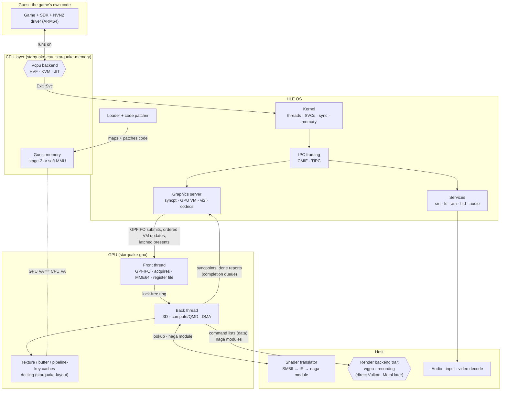
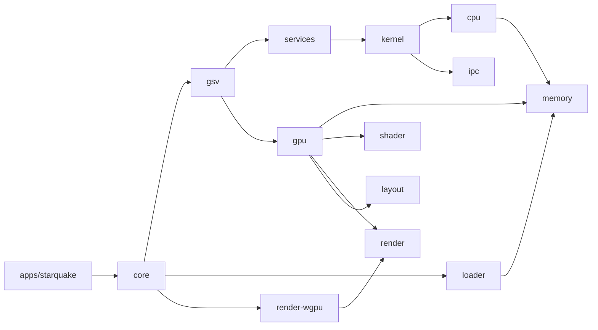

# Architecture (proposal)

Status: proposal, 2026-11-11. What runs today is the walking skeleton described at the end of
this file; the rest is the design it grows into. Background: `switch2-eden-diff-scoping.md`.

## The big picture

A Switch 2 game is an ARM64 program that talks to an OS (Horizon) through system calls, and to a
GPU (Ampere-class) through command buffers. Starquake runs the program's code directly where it
can (Hypervisor.framework, KVM) or translates it (x86-64 JIT), re-implements the OS in Rust (HLE),
and replays the GPU's work on the host GPU through starquake's own render backend trait: wgpu
first on every platform, with direct backends later. The graphics half is specified in
`specs/graphics-server.md`, `specs/gpu-protocol.md`, `specs/shader-pipeline.md` and
`specs/render-backend.md`.



## How a frame flows

1. **Loading.** `loader` parses NSO/NPDM, maps code into guest memory, and patches every
   `mrs xN, cntpct_el0` into a branch to a backend stub (0.9 ns per read instead of 760 ns on
   HVF). It hands the kernel a process description: address-space layout, core mask (0-5),
   PAuth keys, 12 GB memory layout.
2. **Running guest code.** Each of the six application cores is a host thread that owns one
   vCPU and loops: `vcpu.run()` → handle the `Exit` → resume. Guest threads are scheduled onto
   these vCPUs by the HLE kernel; context switches swap `GuestRegs` and PAuth keys.
3. **System calls.** `svc #n` exits to the kernel on the same host thread (no cross-thread hop,
   ~0.76 µs round trip on HVF). `SendSyncRequest` parses the IPC buffer with `ipc` and calls the
   target session's handler in `services` or `gsv`.
4. **Graphics.** NVN2 writes command buffers into guest memory and submits GPFIFO entries
   through `gsv`/`nvsrv`. The GPU front thread parses them, honours semaphore acquires (the CPU
   gates each command buffer this way), keeps the register file, runs MME64 macros, and pushes
   the register changes into a ring. The back thread applies them to engine state and records
   draws and dispatches as plain-data command lists, which the render thread turns into host
   API calls. A semaphore release or syncpoint increment becomes visible to the game only once
   the host GPU has finished the work before it.
5. **Shaders and resources.** Draws ask the shader cache for shaders (SM86 → IR → a validated
   `naga` module, which `gpu` carries to the render backend; wgpu takes it directly) and pull
   resources through the texture and buffer caches (detiling with `starquake-layout`, ASTC
   uploaded as is where the host GPU has it, decoded on the GPU where it does not).
6. **Present.** vi2 present (`gsv` 229) queues the frame and replies at once with the buffers
   still in use. On each 60 Hz tick of gsv's emulated clock, gsv latches one queued frame whose
   fence is reached and hands it to `gpu`, which orders it after the work that drew it and
   passes it to the render backend; the buffer it replaces is freed on the same tick. The game
   waits only when it has no free buffer. A present goes gsv → gpu → render.

(Steps 4–6 amended for the graphics specs. Approved by the owner, 2026-11-12.)

## Threads

| Thread | Count | Does |
|---|---|---|
| vCPU | 6 | Runs guest code; handles SVCs and IPC inline |
| GPU front | 1 | Parses command streams, keeps the register file, runs macros, waits on acquires |
| GPU back | 1 | Engine state, draws/dispatches, guest-keyed caches; fills plain-data command lists |
| Render submit/present | 1 | Turns command lists into host API calls, submits, presents, owns the swapchain |
| Compile pool | N | One pool, created by `core`, shared by shader translation and pipeline builds |
| Audio, input, video decode | 1 each | Host I/O |
| Timers | 1 | Vsync ticks (vi2 31/32 and the present latch), draining gsv's completion queue (syncpoint changes and GPU reports, in one recorded order), the shared syncpoint page's 1 ms bound, kernel timeouts |

(Threads amended for the graphics specs. Approved by the owner, 2026-11-12.)

## Crates and dependency direction



Rules: no cycles, no reaching around a layer, frontends only see `core`. `ipc` works on byte
slices and depends on no other workspace crate; its caller copies the buffer out of guest memory.
Backends are selected by `cfg` (target OS/arch) plus Cargo features, never by runtime checks
scattered through code.

The graphics crates (approved by the owner, 2026-11-12):

- **`starquake-layout`** (block-linear tiling, ported from Mesa's `nil`) is a leaf like `ipc`:
  no workspace dependencies. `gpu` does all detiling with it; gsv uses it only in a test.
- **`starquake-shader` and `starquake-render` do not depend on each other.** The shader crate's
  output is a validated naga module plus tables; `gpu` carries it to the render backend. All
  three use the naga version wgpu uses.
- **`starquake-render`** is the backend trait, its plain-data types and the recording backend,
  with no workspace dependencies. Each host API is its own crate that depends on it:
  **`starquake-render-wgpu`** first (the only crate that names a wgpu type), later a direct
  Vulkan backend, and a native Metal backend only if measured to be needed. `core` picks one.
- Game memory addresses stop at `gpu`; host API types stop at their backend crate.

## Platform matrix

| | macOS arm64 | Linux arm64 | Linux x86-64 (Steam Deck class) |
|---|---|---|---|
| CPU backend | HVF (measured, works) | KVM (planned) | JIT (planned; must emulate PAuth, LSE, RCpc) |
| Counter reads | Patched stub | Patched stub | JIT intrinsic |
| Render backend | wgpu on Metal (nothing to install) | wgpu on Vulkan | wgpu on Vulkan |
| Render backend later | Native Metal only if measured to be needed | Direct Vulkan when Linux work or a title needs a stage wgpu lacks | Same as Linux arm64 |
| ASTC | Native | Native where the driver has it; else decoded on the GPU | Decoded on the GPU (AMD) |
| Memory | Unified: copied (wgpu cannot alias guest memory) | Discrete or unified: copied | Unified (Deck APU): copied |

Every platform starts on wgpu. Guest data is copied into host GPU memory until a direct backend
can alias it on unified-memory hosts. (Platform matrix amended for the graphics specs. Approved by
the owner, 2026-11-12.)

## What makes it agent-friendly

- **One gate** (`cargo xtask ci`), the same locally and in CI, under ~2 s today.
- **Traits at the seams** (`Vcpu`, `GuestMemory`, service handlers, render backend), each with an
  in-memory test implementation, so most logic is testable without a hypervisor or GPU.
- **Golden traces, planned:** record SVC/IPC/GPU-method traces from homebrew runs and diff
  them in tests, so behaviour changes show up as reviewable diffs.
- **Offline harnesses, planned:** recorded MME calls (replay and compare), shader fixtures
  checked against `nvdisasm`, `naga` validation of every translated shader.
- **Auto-stub plus trace** for unknown IPC commands and SVCs, the same tool that let Eden-NX2
  boot titles quickly.

## What runs today: the walking skeleton

The thinnest end-to-end run (`roadmap.md`, "Route to milestone 1"), so that the pieces are
proven to fit before more are built. On macOS on Apple Silicon:

```sh
cargo run -p starquake-testkit --example guest_programs -- <folder>   # writes four test NROs
cargo run -p starquake -- run <folder>/hello.nro --until timeout=10s --artifacts <folder>/out
```

`starquake-core`'s `System` parses the program with the loader (an NRO, or an ExeFS: its
`main.npdm` and its NSO modules), describes its process (from the NPDM: cores, priorities, the
main thread, the handle table and the console, which decides the counter rate and the memory
arrangement; an NRO gets Eden's defaults for a program with no NPDM), creates the process's
memory with the kernel (the modules one after the other at Horizon's address for code and a
stack of the described size in the stack region; text read-execute, rodata read-only, the rest
read-write), rewrites its counter reads with the loader's patcher, creates the process with the
kernel's process creation (which starts its main thread, with a thread-local page), and runs
its threads on six core threads, one vCPU each, as the kernel's scheduler decides, with a timer
thread for sleeps, wait timeouts and time slicing (kernel slice 10). What the kernel's
address space maps reaches guest code through stage-1 tables, a page at a time as the guest
first touches it. Every `svc` goes through the kernel's dispatcher and is recorded in the event
stream; the memory calls (`SetHeapSize`, `SetMemoryPermission`, `SetMemoryAttribute`,
`QueryMemory`, and `GetInfo`'s memory ids) are real, and so is IPC: `ConnectToNamedPort`,
`SendSyncRequest` and closing a session reach the services `crates/core/src/hle.rs` registers
(`sm:` on its port, and `set:sys` behind it), whose handlers run without the kernel lock. The
homebrew fixture (`tests/homebrew/hello/hello.nro`) runs to `ExitProcess` with exit code 0, its
trace matching the reference emulator's line for line. The run ends when the guest calls
`ExitProcess`, crashes, or reaches the timeout, and the artifacts folder gets `summary.json`,
`trace.txt`, `events.bin`, `guest_log.txt`, and `crash.json` and `crash.txt` after a crash
(`guest_log.txt` is an addition to the spec's table: an event keeps a log line's length and
hash, not its text). The
exit codes are the headless contract's (`specs/observability.md`). On other hosts the same
command reports that no CPU backend is available (exit code 2).

The tests are in `crates/core`: `src/machine/tests.rs` drives the loop with scripted vCPUs on
every host (`src/machine/tests/six_cores.rs` steps six cores deterministically), and
`tests/skeleton.rs` runs the testkit's guest programs natively, one of which starts a second
thread on core 1 and joins it.

It is deliberately thinner than the specs. Each provisional part is marked `PROVISIONAL` where
it lives, with what replaces it:

| Provisional part | Where | Replaced by |
|---|---|---|
| Backing is handed out a page at a time from the start of one small RAM region (16 MiB) and never returned, far less than the kernel lets a process reserve; host access to guest memory ignores permissions | `crates/core/src/space.rs`, `crates/cpu/src/hvf.rs` | The backing pools of the execution model, sized as the kernel's accounting says; permission checks on system-call buffers |
| The whole register file is read and written on every `svc`; an abort is lazy backing or the end of the run (nothing is delivered to the guest or write-tracked); the event stream names the process by a fixed number | `crates/core/src/machine.rs`, `crates/core/src/machine/core_loop.rs` | Single-register accessors on `Vcpu`; the fault-delivery and write-tracking slices; process ids from the process table |
| Pointer-authentication keys are fixed (zero) and the same on every core's vCPU, so a thread can move between cores, and `x18` starts at zero where Eden seeds it with a random odd number | `crates/core/src/system.rs`, `crates/kernel/src/sched/scheduler/lifecycle.rs` | The process's keys and seed from the environment's random numbers (not yet scheduled) |
| One process per set of tables: `process::create` builds a fresh scheduler and a fresh process table for each process, so a second process would start its thread ids at 1 and its process id at `0x51` again, and the system calls take the calling thread's process to be the table's own process (any other is an internal failure). The kernel spec (rule 2, "Nothing assumes a single process") has one scheduler holding every thread. No process-local region is reserved (Eden's `KProcess::Initialize` reserves one before any thread) | `crates/kernel/src/process.rs`, `crates/kernel/src/tables.rs`, `crates/kernel/src/svc/thread.rs` | Adding a process to the existing tables: a row in the one process table and the one scheduler, with a handle table and an address space per process; the process-local region reserved in `process::run` |
| The process's address-space id is a constant (1, the first id the kernel's `AsidPool` hands out), not taken from the pool | `crates/core/src/system.rs` | The core loop allocating ids from `starquake_kernel::process::AsidPool` with the backend's width |
| No service of a real run defers: `fsp-srv`'s `Read` would, and has no executor. The core loop delivers the deferred replies a service says are ready (`machine::Ready`), which only its tests' services do | `crates/core/src/hle.rs`, `crates/core/src/machine.rs` | An executor for `fsp-srv` whose finished jobs tell the loop |
| Sessions have no limit: `ConnectToNamedPort` never refuses with `ResultLimitReached` (the process's session count) or `ResultOutOfSessions` (the port's maximum), as Eden's `KClientPort::CreateSession` can | `crates/kernel/src/dispatch/ipc.rs`, `crates/kernel/src/ipc/table.rs` | The later resource-limits slice (kernel spec, "Port plan"), with a session maximum per port |
| Events have no resource limit (`CreateEvent` never refuses with `ResultLimitReached`); a process object is never signalled; a service keeps each event it creates for as long as it lives | `crates/kernel/src/sync.rs`, `crates/kernel/src/dispatch/ipc.rs` | The later resource-limits slice; signalling a process when its state changes (not yet scheduled); a call to close an event in the service framework |
| A run whose cores have all parked while no thread is runnable (queued: a suspended one is not), no wait has a timer, no server holds a deferred request, no thread waits for a reply and every server's handler is in its slot ends as an emulator error. The last two cover the timer thread's deliveries, which wake a deferred request's sender after it is deferred no more and run the handler for requests queued behind it. The rule is right only while no other host thread signals guest events (none does yet) | `crates/core/src/machine/cores.rs`, `crates/kernel/src/dispatch/cores.rs` (`is_stalled`) | The rule counting host-thread signallers (vsync, input) once they exist |
| A request's sender has the id of the process the dispatcher's tables belong to | `crates/kernel/src/ipc/table.rs`, `crates/kernel/src/dispatch/ipc.rs` | Adding a process to the existing tables (above) |
| The dispatcher is told the calling thread by its caller; the core loop names the thread the scheduler gave the core | `crates/kernel/src/dispatch.rs` (`Caller`) | The dispatcher reading the scheduler's current thread of the calling core |
| Lifecycle, fault and guest-log events are recorded by the loop, not the kernel (lifecycle and fault events outside the kernel lock; a guest-log event under it, from the loop's debug sink, with the same time as the call that wrote it). The kernel's address space records nothing: no `Map` event is produced, and its table is not serialisable | `crates/core/src/machine.rs`, `crates/kernel/src/memory.rs` | The kernel's own recording points: lifecycle events with process creation (slice 8); a `Map` event from each of the address space's mutators, a follow-up to slice 6 not yet scheduled; a serialisable address space with the observability spec's snapshots (its step 6) |
| What a run keeps in memory is capped by fixed numbers: the trace's first 100,000 events and the first 4 MiB of guest log text, each with a marker and a count in `summary.json` when it was cut short | `crates/core/src/machine.rs` (`Limits`) | The observability spec's size cap per run, with its flags |
| A failure inside the kernel (its own bookkeeping is inconsistent) is logged and the guest sees "not implemented"; the run goes on | `crates/kernel/src/dispatch.rs` (`fault`) | An outcome that stops the run, once the core loop handles one |
| Lock waits are counted per table but not timed, and not written to `summary.json` | `crates/kernel/src/dispatch.rs` (`LockWaits`), `crates/core/src/machine.rs` | The core loop giving the dispatcher a timer and writing its report into the summary |
| Shared memory has no backing in a run: `SpaceMapper` keeps the kernel's default `Mapper::allocate_shared` and `Mapper::map_shared`, which refuse, so a server's `IpcContext::create_shared_memory` fails inside the kernel. No service makes shared memory yet | `crates/kernel/src/memory/mapper.rs`, `crates/core/src/space.rs` | `SpaceMapper` handing out a run of guest RAM for each shared memory and mapping those pages wherever the guest maps it |
| One VM per run; the hypervisor backend only | `crates/core/src/system.rs` | KVM and JIT backends; a `System` that outlives one program |
| Crash reports have no backtrace or symbols, and name an exception only as a data abort, an instruction abort or (everything else) an undefined instruction: the backend's exits carry the exception's syndrome, but the report does not print it | `crates/core/src/crash.rs` | The crash-report step of the observability spec |
| Of the headless flags only `--until timeout=<n>s` and `--artifacts` exist | `apps/starquake/src/lib.rs` | The observability spec's order of work |
