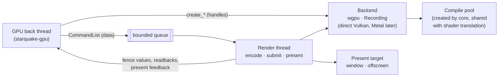

# Render backend: the seam between the emulated GPU and the host GPU

Status: approved by the owner, 2026-11-12 (issue #14).

Every item in "Decisions for the owner" carries the owner's ruling (`docs/decision-log.md`,
2026-11-12), and the text follows them and the seam resolutions of the graphics review guide
(`docs/specs/graphics-review-guide.md`).

This spec decides what `crates/render` is: the one interface through which the emulated GPU
(`crates/gpu`) gets work done on the host GPU, the backends behind it, the thread that submits
and presents, and how a run with no GPU and no window still produces checkable output. The host
API layer, the largest decision in the graphics half, is now taken: wgpu first, behind our own
trait (decision 1). The draft's comparison of the options is kept in decision 1 for the record.

Three sibling specs were drafted at the same time: the graphics server (#11), the GPU front/back
protocol and engine state model (#12) and the shader pipeline (#13). Where this spec depends on
them it says exactly what it assumes, in "Interfaces to neighbouring designs".

## Summary

- **The backend sees host-level work, never guest state.** The GPU back thread turns engine
  state into backend-neutral *command lists*: plain data naming textures, buffers, pipelines and
  draws by handle. A backend turns a list into host API calls. Guest addresses, register
  layouts, block-linear tiling and syncpoints stay on the `gpu` side of the seam.
- **Command lists are data, encoded on the render thread** (decided by the owner, decision 3).
  The back thread only fills a list and hands it over. Encoding into the host API, submitting and
  presenting happen on the render submit/present thread (architecture, "Threads"). Eden-NX2 found
  the GPU thread, not the host GPU, to be the bottleneck (rows 98, 133), and this moves the host
  API's CPU cost off it.
- **Guest caches live in `gpu`; host objects live in the backend** (decided by the owner,
  decision 4). The texture, buffer and pipeline caches (keyed by guest address and guest state,
  invalidated by write tracking) are `gpu`'s. The backend owns the host objects they point to, by
  handle.
- **One recording backend from the first slice.** It implements the same trait, keeps every
  command list as data, and models uploads, copies, clears and presents on the CPU. Tests of the
  GPU path run on any host, and it is the oracle the real backends are checked against.
- **Host API: wgpu first, behind our own trait** (decided by the owner, decision 1, against this
  draft's recommendation). The first real backend is a wgpu backend in its own crate
  (`starquake-render-wgpu`, a working name). No wgpu type crosses into `gpu`. A direct Vulkan
  backend is added when Linux work or a title needs a stage wgpu lacks (geometry, tessellation,
  transform feedback); a native Metal backend is written only if measurements at the performance
  milestone call for it. On the Mac, wgpu drives Metal directly, so nothing is installed.
- **Shaders arrive as a naga module.** The shader pipeline (#13) hands over a validated naga module
  with tables of its resources, inputs and outputs, carried by `gpu`; the wgpu backend gives the
  module straight to wgpu. A later direct backend asks the shader crate for final SPIR-V or MSL
  instead (owner's decision of 2026-11-12).
- **wgpu has no per-view texture swizzle.** `Caps` says so, and `gpu` folds each texture binding's
  swizzle into the shader variant key instead, so it becomes shader variants (decision 1).
- **The guest is paced by the emulated 60 Hz clock and the graphics server's buffer queue, not
  by the host display or a fence wait** (owner's decision of 2026-11-12). Presenting never blocks
  the graphics server and carries no fence to wait on; a headless run has no swapchain at all
  and dumps frames as PNG.

## Where the backend sits



| Thread | Owned by | Touches the host API? | Does |
|---|---|---|---|
| GPU back | `gpu` (#12) | No | Applies engine state, fills command lists, allocates handles, writes staging memory |
| Render submit/present | backend | Yes | Encodes lists into host command buffers, submits, presents, owns the swapchain |
| Compile pool (N workers) | `core`, shared with the shader pipeline (#13) | Yes, for pipeline creation | Build pipelines from shaders and fixed-function state; the same workers translate guest shaders |
| Frontend main thread | the app | Window only | Creates the window and hands its handles to the backend |

One compile pool, created by `core` and handed to both the backend and the shader cache, sizes
the compile threads in one place and needs no dependency between `shader` and `render` (review
guide, M16). Each crate takes the pool through its own small executor trait, which `core`
implements.

Crates (decision 10, implied by the owner's decision 2: "wgpu types stop at the wgpu backend
crate"):

| Crate | Contains | `unsafe` |
|---|---|---|
| `starquake-render` | The trait, every type in it, the recording backend, format tables, the choice of format fallbacks and shader emulation (pure functions), the host shaders' WGSL sources | Denied |
| `starquake-render-wgpu` (working name) | The wgpu backend: the only crate that names a wgpu type | Denied if wgpu's safe API is enough. Creating a surface from the frontend's raw window handles may need wgpu's unsafe surface constructor (guess; open, verification 11, settled in slice R8); if so, a crate-level opt-in for that one call |
| `starquake-render-vulkan` | Later, when scheduled: a direct Vulkan backend | Crate-level opt-in |
| `starquake-render-metal` | Later, only if measurements call for it: a native Metal backend (`objc2-metal`) | Crate-level opt-in |

`gpu` depends on `starquake-render` only. `core` picks a backend by `cfg` and Cargo features and
hands `gpu` an `Arc<dyn Backend>`. Frontends still see only `core`. `starquake-render` depends
on no workspace crate; in particular it never reads guest memory (the one exception, aliasing
guest memory on unified-memory hosts, is deferred: decision 7). It depends on `naga` for the
module type in `ShaderSource::Naga`, at the version wgpu itself uses, so that the shader, gpu and
render crates share one naga (owner's decision of 2026-11-12).

## The backend trait

### Command lists are data

A `CommandList` is a `Vec<Command>` plus the fence value it signals when the host GPU has
finished it. It holds handles and owned bytes, no references and no host objects. That gives
three things at once:

- the back thread never waits on a driver call, and never touches the host API;
- the recording backend is trivial: it keeps the lists;
- a list is serialisable (`serde`, `postcard`), so a host-level capture of a frame can be
  replayed later on any backend, without the emulator (slice R11).

Eden does the same within its Vulkan renderer: the rasterizer records closures into chunks that
a worker thread executes (`eden/src/video_core/renderer_vulkan/vk_scheduler.h` @ cf654052,
`CommandChunk`, `WorkerThread`). Ours records data instead of closures, so it crosses a crate
boundary and can be stored.

The queue between the threads is bounded (a few lists; the number is a setting). When it is full
the back thread waits. That is the back-pressure that slows the guest when the host GPU falls
behind. No reply is held: the guest's fences pass later, because a release or syncpoint increment
becomes visible only once the host GPU has finished the work before it (owner's decision of
2026-11-12); the graphics server latches a frame only once its fence is reached, so buffers come
back later; and a title that waits for a free buffer slows down (owner's decision of 2026-11-12,
buffer queue).

### The trait

```rust
/// The seam to the host GPU. One implementation per host API, plus the recording backend.
/// Send + Sync: the GPU back thread and the compile workers share it.
pub trait Backend: Send + Sync {
    fn caps(&self) -> &Caps;                  // fixed for the backend's lifetime
    fn budget(&self) -> MemoryBudget;         // host memory allowed and in use, for eviction

    // Handles are allocated at once, on the calling thread. The host object is created on the
    // render thread, in order, before the first command list that uses it.
    fn create_buffer(&self, desc: &BufferDesc) -> Result<BufferId, RenderError>;
    fn create_texture(&self, desc: &TextureDesc) -> Result<TextureId, RenderError>;
    fn create_view(&self, texture: TextureId, desc: &ViewDesc) -> Result<ViewId, RenderError>;
    fn create_sampler(&self, desc: &SamplerDesc) -> Result<SamplerId, RenderError>;
    fn create_shader(&self, desc: ShaderDesc) -> Result<ShaderId, RenderError>;
    /// Destroyed once the host GPU has passed `after`; until then the id stays reserved.
    fn destroy(&self, resource: ResourceId, after: FenceValue);

    /// Queues compilation on the compile workers and returns at once.
    fn create_graphics_pipeline(&self, desc: GraphicsPipelineDesc) -> Result<PipelineId, RenderError>;
    fn create_compute_pipeline(&self, desc: ComputePipelineDesc) -> Result<PipelineId, RenderError>;
    fn pipeline_status(&self, id: PipelineId) -> PipelineStatus;   // Compiling | Ready | Failed

    /// Staging memory the caller fills and then names in an `Upload` command.
    fn staging(&self, size: u64) -> Result<StagingSlice, RenderError>;

    /// Hands a finished list to the render thread. Blocks only while the queue is full.
    fn submit(&self, list: CommandList) -> Result<FenceValue, RenderError>;
    fn completed(&self) -> FenceValue;        // highest value the host GPU has finished
    fn wait(&self, value: FenceValue, timeout: Duration) -> Result<WaitOutcome, RenderError>;
    /// Bytes a `Readback` command copied out, once its list's fence has passed.
    fn take_readback(&self, id: ReadbackId) -> Option<Readback>;

    fn set_present_target(&self, target: PresentTarget) -> Result<(), RenderError>;
    fn take_present_feedback(&self) -> Vec<PresentFeedback>;
}
```

`dyn Backend` costs one indirect call per resource creation and per submitted list, not per
draw, so the back thread is not generic over the backend.

`core` constructs each backend with the shared compile pool and with the GPU crate's
wait-while-compiling setting (below); neither is a trait method.

**Open, shared with gpu-protocol (#12):** the GPU back thread sleeps until its ring has entries
*or* a submitted list has completed, because releases and syncpoint increments wait on
completion. `completed()` and `wait()` alone cannot wake it. One way is a wake hook the back thread
installs on the backend, called by the render thread when the completed value moves; neither
spec has settled it (review guide, M14). It is an open item, verification 10.

### Commands

```rust
pub enum Command {
    Upload { from: StagingSlice, to: CopyDst },          // buffer range or texture region
    Copy(CopyDesc),                                      // buffer/texture to buffer/texture
    Blit(BlitDesc),                                      // scaled and filtered (2D engine, present)
    Clear(ClearDesc),                                    // colour, depth, stencil; whole or rect
    SetRenderTargets(RenderTargets),                     // up to 8 colour views + depth/stencil
    Draw(DrawDesc),                                      // pipeline, bindings, vertex/index buffers,
                                                         // dynamic state, direct or indirect params
    Dispatch(DispatchDesc),                              // pipeline, bindings, group counts or indirect
    Readback { from: CopySrc, id: ReadbackId },
    Present(PresentDesc),
    Marker(Marker),                                      // guest submit/draw ids for captures and logs
}
```

- **Render passes are the backend's business.** The guest has no render passes; it changes
  render targets through state. The backend opens a host pass at the first draw after
  `SetRenderTargets` and closes it when the targets change, a copy or readback touches an
  attachment, or the list ends. Load and store actions start conservative (load, store); hints
  from the guest's own invalidate methods can make them cheaper later, which matters on Apple's
  tile-based GPUs.
- **Barriers and image layouts are the backend's business.** Every command says which resources
  it reads and writes, so the backend can insert what its API needs. wgpu inserts them itself
  from each resource's declared usage; a direct Metal backend would need few; a direct Vulkan
  backend needs layout transitions and pipeline barriers.
- **Draw state that is dynamic on the host is in `DrawDesc`**: viewports, scissors, blend
  constants, stencil reference and masks, depth bias, line width. Everything else is in the
  pipeline. `Caps` says which of these the device can set dynamically, and the gpu side keys
  pipelines only on what is not dynamic. Under wgpu only viewport, scissor, blend constant and
  stencil reference are dynamic (decision 1's table); the rest goes into the pipeline key, which
  means more pipelines to compile.

### Handles, lifetimes and fences

- Ids are plain integers with a generation, allocated by the backend's common layer. A stale or
  foreign id in a command is an `Err` when the list is encoded, not undefined behaviour.
- `FenceValue` is one counter per backend. The wgpu backend advances it when wgpu reports that
  the submission holding a list has completed (wgpu reports completion of submitted work; owner's
  decision of 2026-11-12); a direct backend would use a Vulkan timeline semaphore or a Metal
  shared event. `destroy(id, after)` defers destruction until the host GPU is done with the
  object, the way Eden's `DelayedDestructionRing` does
  (`eden/src/video_core/delayed_destruction_ring.h` @ cf654052), but by fence value instead of by
  frame count.
- The gpu side uses fences for three things: reusing or evicting resources; reading back data
  the guest CPU needs (rows 115, 131 say this is rare); and performing guest semaphore releases
  and syncpoint increments, which become visible to the game only once `completed()` has passed
  the fence of the list holding the work before them (owner's decision of 2026-11-12).

### Errors and untrusted input

Every description is derived from guest state, so every one is checked against `Caps` limits
before a host object exists: sizes, mip and layer counts, sample counts, format support,
binding counts, copy extents (start, end and the whole region, in checked arithmetic). A bad
description is a `RenderError`, logged and counted; the gpu side skips the draw or copy. A lost
host device is the one error that ends the run (emulator error, exit code 2).

Guest shaders are untrusted input to the host driver. Under wgpu, wgpu writes the final shader
code from the naga module on its safe path and applies its own checks (owner's decision of
2026-11-12, which names bypassing them as a reason not to emit final code now). A direct backend
later asks the shader crate for final code and states its bounds-check policy in the target it
gives the shader crate: naga's bounds-check policies (`naga::proc::BoundsCheckPolicy`, naga
30.0.1) set to read zero and skip writes for out-of-bounds accesses, unless `Caps` reports that
the device guarantees robust access for that resource kind.

## Resources and who owns the caches

| | `gpu` (#12) owns | The backend owns |
|---|---|---|
| Textures | The texture cache: guest address and layout → `TextureId`, overlap and aliasing rules, write tracking, detiling, eviction policy | Host images, views, memory, format fallbacks, upload and readback paths |
| Buffers | The buffer cache: guest ranges → `BufferId` + offset, write tracking, what is GPU-written | Host buffers and their memory, staging rings |
| Samplers | Sampler pool decoding → `SamplerDesc`, dedup by value | Host sampler objects |
| Pipelines | Pipeline key from guest state → `PipelineId`; the list of keys to precompile on the next boot; the wait-while-compiling setting | Compilation (on the shared compile pool), the host pipeline cache blob on disk where the API offers one |
| GPU-only memory | The lazy store for sparse regions (gpu-protocol, "GPU-only memory") | Host textures and buffers the store creates through the trait |
| Render targets | Which guest surfaces are bound | Host passes, attachments, barriers |

The rule: anything keyed by a guest address or guest register value is `gpu`'s; anything that is
a host object is the backend's. This is a narrower seam than Eden's: its `RasterizerInterface`
(`eden/src/video_core/rasterizer_interface.h` @ cf654052) mixes guest-memory flushing and
invalidation with host draws, and its texture and buffer caches are templates over the Vulkan
runtime. Starquake ports their *policies* (and Eden-NX2's collector lessons, rows 99, 103, 139)
into `gpu`, where they can be tested against the recording backend.

### Buffers and uploads

The back thread asks for a `StagingSlice` (host-visible memory the backend owns), copies guest
memory into it through `GuestMemory`, and names it in an `Upload`. That is one copy from guest
memory into memory the GPU can read, and on unified-memory hosts the GPU reads the staging slice
directly. Readbacks go the other way: the backend copies into host-visible memory and returns
owned bytes once the fence passes; `gpu` writes them into guest memory.

Under wgpu a buffer cannot stay mapped while the GPU uses it (decision 1's table: no persistent
mapping), so the wgpu backend's `StagingSlice` is memory it owns on the CPU side, copied in with
`Queue::write_buffer` and `Queue::write_texture` when the `Upload` is encoded. That is one extra
copy per upload, accepted for now; the staging API does not change if a direct backend later
removes it. Readbacks go through a buffer mapped with `map_async` after the list completes.

### Textures, views, samplers, render targets

- `TextureDesc`: dimension (1D, 2D, 3D, cube, arrays), `PixelFormat`, size, mip count, layer
  count, sample count, usage (sampled, storage, render target, copy). Render targets are
  textures with that usage; there is no separate type.
- `ViewDesc`: format (for reinterpreting views), mip and layer range, component swizzle. The
  guest's texture headers carry a per-texture swizzle. A direct Vulkan backend would express it
  in the view and a direct Metal backend in its texture swizzle, at no shader cost. wgpu has no
  view swizzle (decision 1's table), so the wgpu backend reports `Caps::view_swizzle = false` and
  refuses a non-identity swizzle in a `ViewDesc` with a `RenderError`. `gpu` reads that
  capability and, when it is false, creates identity views and folds each texture binding's
  swizzle into the shader variant key (shader-pipeline, "Pipeline-state specialisation"), so the
  shader applies it to what it samples. This is the one wgpu gap that bites at first frames; it
  costs shader variants, which the owner accepted with decision 1.
- `SamplerDesc`: filters, address modes (including clamp-to-border with a border colour), LOD
  bias and clamps, anisotropy, compare function, reduction mode.

### Formats

`PixelFormat` is the host-neutral list of what the guest can name: Eden's 116 entries
(`eden/src/video_core/surface.h` @ cf654052, `PIXEL_FORMAT_LIST`) are the starting set, with
Mesa's format table (`mesa-nouveau/src/nouveau/nil/nil_formats.csv` @ 52238762, MIT) as the
cross-check for block sizes and component types. Decoding the guest's format and component
fields into a `PixelFormat` is `gpu`'s (Eden's `texture_cache/format_lookup_table.cpp`).

Each backend reports, per `PixelFormat`, what the device can do with it natively (sample, filter,
render, blend, storage, copy). A pure function in `starquake-render` chooses the host format and
the conversion for each guest format from that report, so the choice is tested once, with
synthetic capability tables, for every backend. Known conversions:

| Guest format | When | Host form |
|---|---|---|
| ASTC (all block sizes) | No native ASTC | RGBA8 decoded on the GPU (below) |
| D24 + S8 | Device lacks it (Apple GPUs, guess: confirmed by the device query; under wgpu D24S8 is not guaranteed and D32 float + S8 is an optional feature, decision 1's table) | D32 float + S8; converted on upload and readback |
| Formats the host can't render to or blend | Per report | A wider format, converted where it crosses guest memory |

### Block-linear data

Guest textures and render targets are stored block-linear (64×8-byte GOBs in blocks of GOBs).
Switch 2 uses its own variant: Eden-NX2 applies a bit swap inside each GOB for "native tiling"
(`eden-nx2/src/video_core/textures/decoders.cpp` @ 50fa86bb, `NativeGobOffset`; row 69, also
for ASTC). Detiling happens in `gpu`, before upload, with the leaf crate `starquake-layout`
(gpu-protocol, "Block-linear layout"; review guide, M8), so a backend receives linear rows of
pixels or compressed blocks. `starquake-render` does not depend on the layout crate.

- Mesa describes several GOB variants (`mesa-nouveau/src/nouveau/nil/tiling.rs` @ 52238762,
  `GOBType`: Fermi, Tegra, Turing 2D, Blackwell). gpu-protocol derives that Eden-NX2's bit swap
  is Mesa's `TuringColor2D`, and its slice G5's first test checks it bit for bit; that test closes
  this draft's former verification 5.
- Detiling on the GPU with a compute shader is a later optimisation the backend can offer through
  `Caps` (Eden does it: `eden/src/video_core/host_shaders/block_linear_unswizzle_2d.comp`). The
  CPU detiler stays as the oracle for it. Only then does a render crate depend on
  `starquake-layout`, so that its shader and the CPU path agree.

A render target that only the host GPU ever writes and reads (render targets in GPU-only sparse
regions, row 57) is never detiled or retiled; it exists only as a host texture, held by `gpu`'s
texture cache as part of its lazy store for GPU-only memory (gpu-protocol, "GPU-only memory").

### ASTC

Switch 2 titles use ASTC heavily, mostly 8×8, and its handling dominated Eden-NX2's memory and
performance work (rows 94, 99, 100, 103, 107).

- **Native where the device has it.** Apple GPUs sample ASTC in hardware (scoping doc, "Problems
  that go away"); so do most Arm Linux GPUs. The texture is uploaded as compressed blocks. Under
  wgpu on an Apple Silicon Mac this is verified in source: `wgpu-hal`'s Metal adapter enables ASTC
  LDR on Apple2 and later (decision 1's table). Under wgpu on Vulkan, only where the driver has it.
- **Decoded on the GPU elsewhere** (AMD, desktop NVIDIA; the platform matrix's "transcode"): a
  compute shader decodes blocks into an RGBA8 texture at upload, ported to WGSL from
  `eden/src/video_core/host_shaders/astc_decoder.comp`. A CPU decoder (ported from
  `eden/src/video_core/textures/astc.cpp`) is the test oracle and the fallback.
- **Recompressing to BC1/BC3** to cut memory by 4–8× (rows 99, 103, 107) is deferred: decision 6.
- **Huge ASTC arrays** (8192×8192×68, row 94) need sparse textures or level trimming; deferred.

### Unified memory

On Apple Silicon (and the Steam Deck's APU) the GPU reads the same RAM as the CPU. Aliasing guest
memory as host GPU buffers would remove the upload copy and make GPU writes visible to the guest
at once (scoping doc: "`MTLStorageModeShared` buffers can alias guest memory directly"). Metal can
wrap existing memory (`newBufferWithBytesNoCopy_length_options_deallocator` in objc2-metal 0.3.2,
`MTLDevice`), and Vulkan has `VK_EXT_external_memory_host`. Both need host-page alignment (16 KiB
on Apple hosts), so the natural unit is a whole backing pool, not a guest page.

It is not the first design (decision 7): it makes the GPU write guest memory behind the
write-tracking scheme of the execution model, and the copy path is needed anyway on discrete
GPUs. wgpu's safe API cannot alias host memory at all (decision 1's table), so with wgpu first
aliasing waits for a direct backend. The staging API above is shaped so that aliasing can replace
it later without changing the gpu side: a "staging slice" that is the guest's own memory needs no
copy.

### Memory budget and eviction

`budget()` reports the memory the device allows and what the backend uses (Vulkan
`VK_EXT_memory_budget`; Metal's recommended working set). How the wgpu backend learns the
device's budget is not settled: what wgpu 30 exposes was not checked (open, verification 8).
Until then the wgpu backend reports a configured limit and its own allocations. The caches in
`gpu` decide what to
evict. Eden-NX2's lesson is to size collection by each cache's own use, not by the whole device's
(row 139), and to keep GPU-written buffers out of routine eviction.

## Pipelines

### What a pipeline is made of

```rust
pub struct GraphicsPipelineDesc {
    pub stages: Stages,                     // vertex, tess control/eval, geometry, fragment: ShaderIds
    pub vertex_input: VertexLayout,         // up to 32 attributes and bindings (guest limit)
    pub topology: Topology,                 // incl. quads and line loops (converted, below)
    pub raster: RasterState,                // cull, front face, polygon mode, depth clamp/clip, ...
    pub depth_stencil: DepthStencilState,
    pub blend: [BlendState; 8],             // per target; logic op as a separate field
    pub logic_op: Option<LogicOp>,
    pub targets: TargetFormats,             // colour and depth formats, sample count
    pub emulation: EmulationFlags,          // what the shaders were specialised for (below)
}
```

A shader is created once (`create_shader`) from what #13 hands over (carried by `gpu`) and is
shared by every pipeline that uses it. A stage the backend cannot run (geometry or tessellation
under wgpu) makes pipeline creation fail with a `RenderError`; `gpu` skips and counts the draw.

### Fixed-function state the host lacks

A console GPU has fixed-function features some hosts do not. For each, `Caps` says whether it is
native, and a pure function `emulation(&Caps, &state) -> EmulationFlags` decides what must be
emulated. `gpu` copies the flags into the shader pipeline's variant key (shader-pipeline,
"Pipeline-state specialisation"; review guide, M13), so the shaders are specialised for them,
and the pipeline key includes them. This function is the one place the list is decided; the
shader crate only reads the copied fields. Known items, for wgpu first and for the direct
backends that may follow:

| Guest feature | Host gap | Emulation |
|---|---|---|
| Alpha test | Not in wgpu, Vulkan or Metal | Fragment shader discard (Eden: pipeline key `alpha_test_func`, `vk_pipeline_cache.cpp`) |
| Depth range −1..1 | No switch in wgpu or Metal (decision 1's table); Vulkan needs `VK_EXT_depth_clip_control` | Vertex shader rewrites z (Eden: `convert_depth_mode`) |
| Quads, line loops | Not in any of them | Index rewrite by a compute pass (Eden: `host_shaders/vulkan_quad_indexed.comp`) |
| Primitive restart off | wgpu: restart is implied by `strip_index_format` and cannot be turned off for strips (decision 1's table); MoltenVK and Metal always restart (Eden: `vk_graphics_pipeline.cpp`, "MoltenVK/Metal always has primitive restart enabled") | Rewrite indices that equal the restart value |
| Logic ops | Not in wgpu or Metal; not in MoltenVK (Eden: `vulkan_device.cpp`, MoltenVK fallback list) | None exact; draw without it and count it (later: framebuffer fetch on Apple GPUs) |
| Geometry shaders | Not in wgpu, Metal or MoltenVK (same list) | Skipped and counted; later a direct Vulkan backend (decision 1's trigger) or compute emulation |
| More than 16 vertex attributes | The guest allows 32. wgpu reports the device's `max_vertex_attributes` (the value on this Mac is checked in verification 1); MoltenVK caps at 16 (Eden: `vulkan_device.cpp`, "MVK driver breaks ...") | Fetch extra attributes in the vertex shader from a storage buffer |
| Integer render target outputs | MoltenVK needs the shader's output type to match (Eden: `vk_pipeline_cache.cpp`, `color_output_types`); whether wgpu's pipeline validation demands the same is a guess, settled in slice R7 | Typed outputs in the fragment shader |
| Per-texture component swizzle | No view swizzle in wgpu (decision 1's table) | Not an `EmulationFlags` item: `gpu` reads `Caps::view_swizzle` and puts the swizzle of each binding into the shader variant key (see "Textures, views, samplers, render targets") |
| Transform feedback | Not in wgpu or Metal; unverified for MoltenVK | Deferred |

All Eden paths cited are under `eden/src/video_core/renderer_vulkan/` or
`eden/src/video_core/vulkan_common/` @ cf654052.

### Shader emission

#13 hands over, through `gpu`, a validated `naga::Module` with its `ModuleInfo` and tables of the
resources, inputs and outputs it uses, with group and binding numbers already assigned in the
module by the shader crate (its binding convention, defined once there). `gpu` puts the module
in `ShaderDesc` as `ShaderSource::Naga` and converts the tables into the backend-neutral
`ShaderInterface`.

- **wgpu backend:** passes the module to wgpu (`ShaderSource::Naga` in wgpu, feature `naga-ir`),
  which validates it and writes the final code for its own backend on its safe, checked path. The
  render crate runs no naga writer on guest shaders. It builds bind group layouts and pipeline
  layouts from `ShaderInterface`.
- **A direct backend, later:** does not run naga's writers itself either. It states the form it
  wants (SPIR-V with its descriptor-set map, or MSL with its buffer, texture and sampler indices)
  and its bounds-check policy in the target it gives the shader crate when the shader cache is
  created, and receives `ShaderSource::SpirV` or `ShaderSource::Msl` (owner's decision of
  2026-11-12: "the backend says which form it wants").

The backend's own helper shaders (present blit, clears, quad index rewrite, ASTC decode, later
detile and BC encode) are written in WGSL (decision 12). wgpu takes WGSL directly; a test
validates every one with naga, with no GPU. A later direct backend translates the same sources
with naga at startup. Naga is pure Rust, so neither path needs a build step.

### Compiling without stalling a frame

- `create_*_pipeline` returns an id at once and queues the work on the shared compile pool. wgpu's
  pipeline creation is synchronous (decision 1's table), so the wgpu backend calls it on a pool
  worker and marks the id ready when it returns.
- The render thread meets a draw whose pipeline is still compiling. What it does follows the
  GPU crate's single wait-while-compiling setting, which covers shader translation and pipeline
  builds alike and which `core` passes to the backend when it creates it (review guide, M10;
  decision 5, shared with gpu-protocol 9 and shader-pipeline 6, makes waiting the default and
  skipping an opt-in once the persistent caches exist): **wait** for it
  (correct frames, deterministic frame dumps; the back thread keeps running until the queue
  fills) or **skip** the draw and count it (smooth, with visible gaps, what Eden calls
  asynchronous shaders: `vk_pipeline_cache.cpp`, `use_asynchronous_shaders`). Translation waits
  block the back thread; pipeline waits block the render thread.
- A pipeline that fails to build is cached as failed and its draws are skipped and counted once
  per pipeline, not logged per draw (row 90 and 112: cache rejections negatively).
- Two disk caches, both outside the repository, both versioned and refused on mismatch: the gpu
  side's list of pipeline keys seen (to precompile at the next boot, the way Eden's
  `LoadDiskResources` does), and the backend's own driver cache blob where the API has one
  (wgpu's `PIPELINE_CACHE` is Vulkan only and unimplemented on Metal, decision 1's table, so on
  the Mac there is none at first; a direct backend would use `VkPipelineCache` or Metal's binary
  archives).

Eden-NX2 saw compile stalls push the game far ahead of the GPU when the present wait timed out
(row 59). Waiting on the render thread rather than the back thread keeps that bounded without
any wait in the present path: a frame's fence is reached only once the host GPU has finished it,
the graphics server latches a frame only then, and a title that runs ahead runs out of free
buffers (owner's decisions of 2026-11-12).

## The render thread, presentation and pacing

### Submit

The render thread takes lists in order, creates any host objects they introduce, encodes them,
submits, and signals the list's fence value when the host GPU finishes. One host queue to start.
The back thread never calls into the host API, so Eden-NX2's crashes from two threads recording
into one scheduler (row 143) have no counterpart here.

**An ordering the graphics server relies on.** Lists are encoded and submitted in the order they
arrive, on one host queue, and a command that writes an image is ordered after an earlier command
that reads it, including the present blit. The wgpu backend gets this from wgpu's own usage
tracking on one queue; a direct backend gets it from the barriers it inserts. The graphics server
frees a presented buffer on the vsync tick that latches the next frame, not on a report from
here (owner's decision of 2026-11-12, buffer queue), so a draw into a buffer the game has just
got back must not change the frame still being shown. That this ordering holds under wgpu is a
guess (the inference the review guide flagged in M3); slice R8 pins it with a test on the wgpu
backend: present an image, submit a list that draws into it, and check the presented pixels are
the first frame's.

### Present targets

```rust
pub enum PresentTarget {
    /// A window the frontend created; `raw-window-handle` 0.6.2 display and window handles.
    Window(WindowHandles),
    /// No window: presents are counted and dumped on request. Headless runs and tests.
    Offscreen,
    // Exported(..): later, shared images for an embedding frontend (GPUI). See "Deferred".
}
```

The frontend owns the window and its event loop; the backend owns the surface and swapchain made
from the window's handles (a wgpu surface and its configuration). On macOS the surface's Metal
layer is attached on the main thread (AppKit requires view changes there), and the render thread
presents into it; where the wgpu surface is created so that this holds is settled in slice R8.

The swapchain uses a mode that never makes the render thread wait for the host's vblank when a
newer frame is ready (mailbox, or immediate where mailbox is missing; FIFO as the last resort;
wgpu's present modes have these names).
When the guest presents faster than the display, the newest frame wins and the others are counted
as dropped.

### Presenting a guest framebuffer

A vi2 present (gsv 229) names an image; Eden-NX2 found it to be a block-linear RGBA8 surface in
the native GOB layout at GPU address equal to CPU address
(`eden-nx2/src/core/hle/service/nx2_gsv.h` @ 50fa86bb, `Composite`; row 48). The path:

1. gsv (#11) queues the image when the game presents (vi2 229 replies at once). On a vsync tick
   it latches the oldest queued frame whose fence is reached, which under the owner's decision
   means the host GPU has finished it, and passes a `PresentRequest` (the image's GPU address,
   size, pitch, block height and format, and the shown area) to `gpu` through
   `GpuFront::present`. The request carries no fence and nothing waits on one.
2. `gpu` (#12) orders it after everything it was given before it, finds the image in the texture
   cache (it is normally a render target the host just drew), or detiles and uploads it from
   guest memory if the CPU wrote it, and records `Command::Present` with that view, the source
   rectangle, the transform and a frame number.
3. The render thread blits the view to the swapchain image (scaled to the window, filtered,
   converted from the guest format; under wgpu, a render pass that draws the helper blit shader
   into the surface texture) and presents. With `Offscreen` there is no blit and no swapchain.

### Pacing at 60 Hz

The guest is paced by the emulated vsync and the graphics server's buffer queue (owner's decision
of 2026-11-12): gsv's 60 Hz events (vi2 31 and 32, row 82), driven by the timer thread through
`Env`; a present reply that returns at once with the buffers still in use; and a tick that shows
one ready frame and frees the buffer it replaces. The render backend does not pace the guest,
never blocks a present request, and frees nothing (decision 8). That keeps guest-visible timing
independent of the host display (60, 120 Hz or none), makes headless runs and `--clock fixed`
behave like windowed ones, and leaves replay intact. The backend reports `PresentFeedback` (frame
number, shown or dropped, host time) for statistics and the frontend's frame counter; gsv must not
let it change guest-visible behaviour.

### Frame dumps and headless runs

The observability spec's `frames/` folder and `--until frames=N` need pixels without a window.
`PresentDesc` has a `dump` flag; for a dumped frame the render thread reads back the presented
view at the guest's own resolution (not the window's, so dumps don't depend on window size) and
hands an RGBA8 image to a `FrameSink` the app installs. The app writes the PNG (the `png` crate,
0.18.1, pure Rust); the render crate does no file I/O.

## The recording backend

`RecordingBackend` implements the trait with no GPU:

- It keeps every submitted list and every resource description, and renders them as a text
  snapshot (`insta`) for tests on the gpu side: "this method stream produced these draws with
  this state".
- It models on the CPU the commands that have exact answers: uploads, copies, clears, unscaled
  blits, readbacks and presents, for uncompressed colour formats. Draws and dispatches are
  recorded, not executed; a texture a draw has written is marked *unknown*, and a readback of an
  unknown region returns `Unknown`, not wrong pixels.
- Fences complete when a list is submitted; pipelines are ready at once, or follow a script, so a
  test can exercise the wait and skip policies.

It serves three purposes: tests of `gpu` and of the present path on any host and in CI; the
`null` backend for runs that need no pixels (Eden has one, `renderer_null`); and a differential
oracle: the same list run on the wgpu backend (and later on each direct backend) must give
bit-identical readbacks wherever the recording backend has an answer.

## Platform matrix

| | macOS arm64 | Linux arm64 | Linux x86-64 (Steam Deck class) |
|---|---|---|---|
| Backend at bring-up | wgpu on Metal | wgpu on Vulkan | wgpu on Vulkan |
| Backend later | Native Metal only if measurements at the performance milestone call for it (decision 1) | Direct Vulkan when Linux work or a title needs a stage wgpu lacks (decision 1) | Same as Linux arm64 |
| ASTC | Native on Apple GPUs (verified in `wgpu-hal`'s Metal adapter) | Native on most Arm GPUs where the driver exposes it; else GPU decode | GPU decode (AMD has none) |
| Memory | Unified: copy (wgpu has no safe aliasing; decision 7) | Unified or discrete: copy | Unified APU: copy |
| Window | wgpu surface over the frontend's window (`CAMetalLayer`) | wgpu surface over X11 or Wayland | wgpu surface over X11 or Wayland |
| CI with no GPU | Recording backend | Recording backend | Recording backend; the wgpu backend on lavapipe if the experiment passes (decision 9) |

wgpu drives Metal directly on the Mac, so nothing is installed there (owner's decision of
2026-11-12). On Linux it uses the system's Vulkan driver at run time. The owner's decision records
wgpu as safe pure Rust, so building it needs no C or C++ toolchain; the default features are
checked against the project's dependency rules when the dependency is added.

## Interfaces to neighbouring designs

The four graphics drafts were amended together on 2026-11-12 so that every shared type and call
below has the same name in each.

### Graphics server (#11)

Assumed of #11:

- It owns vsync emulation (vi2 31/32 events at 60 Hz from the timer thread, through `Env`) and
  pacing through its buffer queue: vi2 229 replies at once with the buffers still in use; each
  tick latches at most one frame whose fence is reached and frees the buffer that frame replaces
  (owner's decision of 2026-11-12; rows 55, 59, 71, 82, 108). The fence-wait mode is a per-run
  fallback inside gsv, as a deferred reply; it changes nothing here.
- It frees a presented buffer on that tick, not on a report from the render backend. That is
  safe because of the ordering in "Submit" (a guess, pinned by slice R8).
- It describes a latched frame as a `PresentRequest` (a `crates/gpu` type: the image's GPU
  address, width, height, pitch, block height and format, the shown area, the layer and display)
  and hands it to `gpu` through `GpuFront::present`, not to `render` directly. This differs from
  the arrow "gsv → render" in `architecture.md`: going through `gpu` is what orders the present
  after the draws that make the frame, and keeps the dependency direction `gsv → gpu → render`.
- It never blocks on the host display.

Offered to #11: `PresentFeedback` (through `gpu`), for statistics only. It never frees a buffer
and never changes guest-visible behaviour.

### GPU front/back protocol and engine state (#12)

Assumed of #12:

- The back thread builds `CommandList`s of `Command`s from engine state and submits them; it is
  the only thread that calls `submit`. It allocates handles through the trait and never touches
  the host API. These are this spec's types; gpu-protocol uses them as they are (owner's decision
  of 2026-11-12, command lists as data; review guide, M14).
- `gpu` owns the guest caches (texture, buffer, sampler, pipeline keys and the list of keys to
  precompile), write tracking and invalidation, eviction policy (using `budget()`), the lazy
  store for GPU-only memory, detiling into linear data before upload (with `starquake-layout`),
  guest format decoding into `PixelFormat`, and the wait-while-compiling setting.
- It performs guest semaphore releases and syncpoint increments only once `completed()` has
  passed the fence of the list holding the work before them (owner's decision of 2026-11-12).
- It copies guest memory into `StagingSlice`s itself and writes readback bytes into guest memory
  itself; `render` never sees a guest address.
- It orders a present after everything given to it before, and emits `Command::Present`. It does
  not wait on a fence for a present.
- It keys pipelines on everything in `GraphicsPipelineDesc` that `Caps` says is not dynamic.
- It copies `emulation()`'s `EmulationFlags` into the shader variant key, and, when
  `Caps::view_swizzle` is false, each texture binding's swizzle too.
- It carries the shader crate's naga module into `ShaderDesc` as `ShaderSource::Naga` and
  converts the shader's resource, input and output tables into `ShaderInterface`.

Offered to #12: the trait, every description type, `Caps` (including `view_swizzle`) and
per-format capabilities, the format fallback choice, `emulation()`, the recording backend with
its snapshot format, and fences.

Open with #12: how the back thread wakes when a list completes (see "The trait").

Threads and memory: the back thread owns the command list it is filling and the staging slices it
has taken; once submitted, both belong to the backend. The render thread belongs to the backend;
the compile pool is `core`'s.

### Shader pipeline (#13)

Assumed of #13 (through `gpu`; `shader` and `render` do not depend on each other):

- It hands over, per guest shader and specialisation, a `ShaderSet` of `HostShader`s: each a
  validated `naga::Module` with its `naga::valid::ModuleInfo` (`HostCode::Naga`), its stage, and
  tables of the resources it uses (`ResourceSlot`: kind, group and binding as assigned in the
  module, guest source), its inputs and outputs, its driver-constants layout and its
  requirements. `gpu` converts the tables into `ShaderInterface`. All crates use the naga
  version wgpu uses (owner's decision of 2026-11-12).
- It specialises on the variant key `gpu` builds, which includes the fields copied from
  `EmulationFlags` (alpha test, depth-range rewrite, attribute fetch from a buffer, typed
  outputs, primitive-restart index handling where it is in the shader) and, under wgpu, texture
  swizzles. It takes robust-access and feature facts from `Caps` through the target `core` gives
  it.
- It produces modules wgpu accepts. Features naga or wgpu lack (geometry and tessellation stages,
  mesh shaders on Metal, physical pointers for global memory) are flagged by #13, not worked
  around here.
- For a later direct backend, it emits final SPIR-V or MSL on request, with the binding map and
  bounds-check policy that backend states (`HostCode::SpirV`, `HostCode::Msl`).

Offered to #13: the `EmulationFlags` table and `Caps` facts, and, for testing, the recording
backend and a wgpu backend that can run a translated shader (locally on the Mac; in Linux CI on
lavapipe if the experiment passes, decision 9).

`ShaderDesc` accepts a naga module, SPIR-V or MSL (`ShaderSource::{Naga, SpirV, Msl}`). Under
wgpu, guest shaders always come as `Naga`; SPIR-V and MSL serve a later direct backend, captures
and experiments.

## Port slices

One pull request each. "Offline" means no game; "no GPU" means it runs in the gate on any host.
Slices in the same parallel group can be built at once once their dependencies have landed. The
slices were re-cut on 2026-11-12 for a wgpu backend crate (`starquake-render-wgpu`, working name)
instead of a Vulkan backend running on MoltenVK; the recording backend still comes first. "Needs
a GPU" means the test runs locally on the Mac through wgpu on Metal, skipped with a notice where
no GPU adapter exists, and is required in Linux CI on lavapipe if verification 3 passes; until
then it is local-only, like the hypervisor tests (decision 9).

| # | Slice | Depends on | References | Test, offline? | Parallel group |
|---|---|---|---|---|---|
| R0 | `starquake-render` types: ids, descriptions, `PixelFormat` with block sizes and properties, `Caps` (with `view_swizzle`), `Command`, `CommandList`, `ShaderSource::{Naga, SpirV, Msl}`, `ShaderInterface`, the trait, `RenderError`, description validation against `Caps` | none | `eden/src/video_core/surface.h`, `mesa-nouveau/src/nouveau/nil/nil_formats.csv` | No GPU: format table checked against the Mesa table; golden bytes for a serialised list covering every command; every limit tested at the edge on both sides | A (alone) |
| R1 | Recording backend: lists, snapshots, the CPU model of uploads, copies, clears, blits, readbacks, presents; `Unknown` regions | R0 | `eden/src/video_core/renderer_null/` (shape only) | No GPU: hand-computed pixel results; a draw marks its target unknown | B |
| R2 | Format fallback choice and `emulation()` as pure functions | R0 | Eden's MoltenVK paths cited above; `vulkan_device.cpp` format checks; decision 1's wgpu table | No GPU: synthetic capability tables, every combination, including a wgpu-shaped table | B |
| R3 | CPU ASTC decoder | R0 | `eden/src/video_core/textures/astc.cpp` | No GPU: blocks encoded by hand from the ASTC specification, checked against an independent decoder as a dev-dependency (`astc-decode` 0.3.1, guess: suitability to check) | B |
| R4 | Host shaders: WGSL sources and their naga validation; the present blit and clear shaders | R0 | `eden/src/video_core/host_shaders/vulkan_present.*`, `full_screen_triangle.vert` | No GPU: every host shader parses and validates with naga | B |
| R5 | wgpu backend core (`starquake-render-wgpu`): instance, adapter and device choice, `Caps` from the adapter's features and limits, resources, staging through `write_buffer`/`write_texture`, uploads, copies, clears, readbacks, fences from wgpu's completion reports, the render thread, `Offscreen` target, the completion wake (once settled with #12) | R0, R1 | wgpu 30.0.1 (crates.io); `eden/src/video_core/renderer_vulkan/vk_scheduler.*`, `vk_staging_buffer_pool.*` for the shape of a render thread and staging | Needs a GPU: the same lists run on the recording backend and on wgpu give bit-identical readbacks | C |
| R6 | Pipelines: shader modules from naga modules, bind group and pipeline layouts from `ShaderInterface`, graphics and compute pipeline creation on the compile pool, wait and skip per the GPU crate's setting, failed-pipeline cache, driver cache blob where wgpu offers one | R4, R5 | `renderer_vulkan/vk_pipeline_cache.*`, `vk_graphics_pipeline.*`, `fixed_pipeline_state.*` (policy only) | Needs a GPU: hand-built naga test modules; scripted compile delays exercise both policies | D |
| R7 | Draws and dispatches: render targets and lazy passes, bind groups, vertex and index buffers, dynamic state, direct and indirect draws, quad and line-loop index rewrite, typed outputs | R6 | `renderer_vulkan/vk_rasterizer.*`, `vk_render_pass_cache.*`, `vk_update_descriptor.*` (policy only) | Needs a GPU: synthetic scenes with exactly computable pixels (axis-aligned rectangles covering whole pixels, flat colours) | E |
| R8 | Window presentation: wgpu surface from window handles, present modes, resize, newest-frame-wins queue, `PresentFeedback`; the present-then-write ordering test ("Submit") | R4, R5 | `renderer_vulkan/vk_swapchain.*`, `vk_present_manager.*`, `vk_blit_screen.*` (policy only) | Mode choice and the frame queue are pure functions, tested with no GPU; the ordering test needs a GPU; the window path is checked by hand on a Mac and a Linux desktop | D (with R6) |
| R9 | Frame dumps: `dump` flag, `FrameSink`, PNG writing and `frames/` in the app, `--until frames=N` | R1 (pixels from R5) | observability spec, "Headless runs" | No GPU: a present of an uploaded image through the recording backend gives a known PNG | C (with R5) |
| R10 | GPU ASTC decode (WGSL compute) for devices without native ASTC | R3, R4, R5 | `eden/src/video_core/host_shaders/astc_decoder.comp` | Needs a GPU, with native ASTC switched off in `Caps` on the Mac: bit-identical to the CPU decoder on the same blocks | D |
| R11 | Host-level capture and replay: write submitted lists and their staging bytes to a file; `starquake render-replay <capture> --png <dir>` on any backend (renamed from `gpu-replay`, which is gpu-protocol's command; review guide, M15) | R1, R5 | none (new) | No GPU for the format (golden bytes, version refused on mismatch); replay on the recording backend in the gate | D |
| R12 | `starquake-core` wiring: backend choice by `cfg` and features, the shared compile pool for shader translation and pipelines (review guide, M16), the CLI's `--window` (decision 11) | R5, R8, R9 | none | Runs the recording backend end to end in the gate | F |

Group A lands first. Group B is four slices in parallel. R5 and R9 can run together (C); R6, R8,
R10 and R11 can run together after R5 (D). R7 follows R6. Up to four build agents fit the
machine limits in `roadmap.md`.

Later slices, in order of expected need: queries and conditional rendering; BC recompression of
ASTC; GPU detiling; a direct Vulkan backend (when decision 1's trigger is met: `ash` or
`vulkanalia`, lavapipe in CI, Eden's Vulkan renderer as the port reference; see "Deferred");
sparse textures and mesh and task shaders (both need a direct backend or a wgpu feature that is
experimental today); unified-memory aliasing; a native Metal backend only if measured to be
needed. Each is listed under "Deferred" with how it fits.

## What to verify before building

In order of how much each could change the design:

1. **What wgpu reports on this Mac.** A few lines printing the adapter's features and limits
   under wgpu 30 on Metal: ASTC, `max_vertex_attributes`, D32 float + S8, clip distances,
   dual-source blending, subgroups, f16 and 64-bit shader types, binding arrays with non-uniform
   indexing, `EXPERIMENTAL_MESH_SHADER`. Needs nothing installed. Decides what the wgpu backend
   reports in `Caps` and which `EmulationFlags` are set on the Mac.
2. **Hand-built naga modules through wgpu.** Do modules built in code (not parsed from WGSL),
   with the features guest shaders need, pass wgpu's own validation when created as
   `ShaderSource::Naga`? In particular, does wgpu run naga's uniformity analysis on them, which
   would reject derivatives in divergent control flow that the shader crate validates with that
   check off (shader-pipeline, "The backend through naga")? Shared with shader-pipeline's
   experiment E1.
3. **wgpu on lavapipe on the CI runner:** that Ubuntu's Mesa package installs lavapipe, which
   version, whether wgpu's Vulkan backend runs this backend's tests on it, whether its output is
   bit-identical between runs, and whether it offers ASTC. Decision 9 makes the GPU tests
   required in Linux CI if this passes, and local-only if it fails.
4. **Aliasing a guest backing pool as a GPU buffer on Apple Silicon:** largest buffer the device
   accepts, 16 KiB alignment, cost, and how GPU writes interact with the execution model's write
   tracking (a GPU write does not fault, so the caches must learn of it another way). Needs a
   direct backend or wgpu's unsafe interop; decides when decision 7 is revisited.
5. **The Switch 2 GOB layout:** closed by gpu-protocol's slice G5, whose first test compares
   Eden-NX2's `NativeGobOffset` with Mesa's `TuringColor2D` bit for bit. Kept here so the number
   still points somewhere.
6. **Cost of encoding on the render thread:** a synthetic stream of 5,000 draws a frame through
   the recording backend, then through wgpu, to check the back thread's share is small and the
   render thread keeps up despite wgpu's per-call validation. Decides whether the command list
   format needs to be denser, and is the first measurement toward decision 1's Metal trigger.
7. **Whether hosted macOS CI runners can create a Metal device at all** (guess: they cannot use
   the GPU). Decides whether wgpu-on-Metal tests can ever run in CI or only locally, like the
   hypervisor tests.
8. **How the wgpu backend learns the memory budget:** what wgpu 30 exposes about device memory
   use and limits, if anything. Until known, `budget()` reports a configured limit.
9. **The present-then-write ordering under wgpu** ("Submit"), which the graphics server's buffer
   release relies on. Slice R8's test; listed here because a failure changes #11's release rule.
10. **The completion wake-up** (review guide, M14; "The trait"): how the GPU back thread sleeps
    until its ring has entries or a submitted list completes. A wake hook the back thread
    installs, called by the render thread when the completed value moves, is the leading
    candidate. Settled with gpu-protocol (its verification 13) before R5 and G15.
11. **Whether surface creation needs `unsafe`:** whether wgpu 30 can create a surface from the
    frontend's raw window handles through its safe API, or only through its unsafe constructor.
    If only the latter, `starquake-render-wgpu` opts in at crate level for that one call ("Where
    the backend sits"). Settled in slice R8.

## Decisions for the owner

Every item carries its outcome; the original text stays below it, for the record. The rulings
are in `docs/decision-log.md` (2026-11-12).

1. **Decided by the owner, 2026-11-12:** (e), wgpu first behind our own trait, against this
   draft's recommendation (b); direct Vulkan when needed, native Metal only if measured.

   **The host API layer.** The emulator needs one way to drive the host GPU on macOS and Linux.
   The owner already knows `wgpu` and asked whether it is a viable choice, so that question is
   answered first, then the options are compared.

   **Is `wgpu` viable?** Checked against the published `wgpu` 30.0.1 (2026-08-22) source:
   `wgpu-types` `Features` and `render.rs`, the `wgpu` device, buffer and render-pass API, and
   `wgpu-hal`'s Metal adapter. "First frames" means milestone 3: a simple scene drawn and
   presented.

   | What a console GPU emulator needs | `wgpu` 30.0.1 | Needed for first frames? |
   |---|---|---|
   | Vertex, fragment and compute stages | Yes | Yes |
   | Geometry and tessellation stages | No. There is no such stage in the API | No; some titles later |
   | Mesh and task stages | Experimental (`EXPERIMENTAL_MESH_SHADER`); on Metal only from hand-written shaders, naga can't emit them there | No; needed later (row 89) |
   | Transform feedback | No | No; some titles later |
   | Logic ops | No | No; rare |
   | Depth clamp / unclipped depth | Yes (`DEPTH_CLIP_CONTROL`, `unclipped_depth`) | Yes |
   | Depth range −1..1 | No switch; vertex shader rewrite (the same as on Metal) | Yes, through the shader |
   | Clip distances | Yes (`CLIP_DISTANCES`, Vulkan and Metal) | Likely |
   | Polygon mode line and point, conservative raster | Yes, as optional features | No |
   | Primitive restart control | Only implied by `strip_index_format`; can't be turned off for strips | Rarely |
   | Per-texture component swizzle in a view | No. Must become a shader variant per binding | **Yes**: guest textures commonly swizzle |
   | Dynamic state | Viewport, scissor, blend constant, stencil reference only; cull mode, depth bias, depth and stencil tests are baked into the pipeline | Works; more pipelines to compile |
   | Border colours, clamp-to-zero | Yes, as optional features | Sometimes |
   | ASTC | Yes on Apple Silicon Macs: `wgpu-hal`'s Metal adapter enables LDR on Apple2+, HDR on Apple6+, 3D on Apple3+. On Vulkan only where the driver has it | **Yes** |
   | BC | Yes on Macs (Metal adapter) and desktop Vulkan | Yes, for some formats |
   | D24S8 | Not guaranteed; D32 float + S8 is an optional feature | Yes, through a fallback |
   | Host memory import or aliasing on unified memory | Not in the safe API. `Device::create_buffer_from_hal` wraps a raw Metal or Vulkan buffer (unsafe), but wgpu's tracking then treats guest-written memory as its own | No; a later performance step |
   | Persistent mapping | No. Buffers are mapped with `map_async` and must be unmapped before the GPU uses them; `MAPPABLE_PRIMARY_BUFFERS` relaxes usages, not that rule. Uploads go through `Queue::write_buffer`, which copies into wgpu's own staging | No; costs one extra copy per upload |
   | Pipeline compilation control | Creation is synchronous but may run on worker threads. No compile-in-background handle | Enough for first frames |
   | Pipeline caching | `PIPELINE_CACHE`: Vulkan only; "unimplemented" on Metal | No; a startup-time issue later |
   | Feeding our shaders | Yes: `ShaderSource::Naga` takes a `naga::Module` directly (feature `naga-ir`), or SPIR-V/MSL by `create_shader_module_passthrough` | Yes |
   | CPU cost per call | Validation and resource-state tracking on every command | No; matters at milestone 5, on the thread Eden-NX2 found was the bottleneck |
   | Sparse resources | No | No; needed later (row 87) |

   **Escape hatches.** `wgpu` exposes the objects underneath (`as_hal` on the instance, adapter,
   device, queue and buffers; `as_hal_mut` on a command encoder; `create_*_from_hal`). They work
   for one-off interop: wrapping an external buffer, presenting into a shared image. They are not
   a workable way to add a missing pipeline stage or transform feedback, because wgpu's own
   barrier and lifetime tracking does not see commands recorded behind its back, and `wgpu-hal`
   is an unsafe API that changes with every wgpu major version (they share the version number).
   Adding a stage wgpu lacks means writing that part of a direct backend.

   **So: viable for first frames, not for the finished emulator.** The one gap that bites at
   first frames is the missing view swizzle (shader variants); the rest bite later: geometry,
   tessellation, transform feedback and mesh stages as titles need them, then the extra copy,
   per-call validation and no aliasing when performance work starts. Every one of those ends in
   a direct Vulkan backend, a direct Metal backend, or both.

   **Is "wgpu first behind our own trait, direct backends later" sound or a trap?** It is sound
   if three things hold, and a trap if any slips: the trait and command lists stay ours (no wgpu
   type crosses into `gpu`); the wgpu backend is planned as a bring-up and fallback backend, not
   extended through escape hatches; and the direct backends are scheduled, not left for "later".
   This design already has the first property, so wgpu would be one more implementation of the
   same trait. Its cost is a third backend: wgpu now, then Vulkan and Metal, instead of two.

   The options compared:

   | | (a) `wgpu` as the only layer | (b) Vulkan everywhere (`ash`), MoltenVK on macOS for bring-up, native Metal later | (c) Vulkan and native Metal from the start | (d) Metal first, Vulkan later | (e) `wgpu` first behind our trait, direct Vulkan and Metal later |
   |---|---|---|---|---|---|
   | Console features | The table above | Full on Linux. MoltenVK lacks geometry shaders, logic ops, cull distance and wide lines, and caps vertex attributes at 16 (Eden's workarounds) | Full where each API allows | Full on Mac; Linux waits | The table above until the direct backends land |
   | ASTC on the owner's Mac | Native (verified in `wgpu-hal`) | Through MoltenVK: to verify | Native | Native | Native |
   | Memory control on unified memory | Only through unsafe interop | Vulkan import where the driver offers it; through MoltenVK to verify | Full | Full on Mac | Later, with the direct backends |
   | CPU cost on the hot path | Validation on every call | Thin | Thin | Thin | Validation until replaced |
   | Backends written in total | One, never finished | Two (Vulkan, then Metal) | Two at once | Two, Linux late | Three |
   | Extra install on the Mac | None | MoltenVK (C++ library at run time) | None | None | None |
   | Reference to port from | None for an emulator | Eden's Vulkan renderer | Eden for Vulkan only | None | Eden later |
   | Testing without a GPU | Recording backend; lavapipe | Recording backend; real backend on lavapipe | Same; Metal not in CI | Metal not in CI | Same as (a), then (b) |
   | Stability | Breaking major releases several times a year (29.x and 30.x both in 2026) | `ash` stable (0.38, 2024) | Same | Same | wgpu churn until replaced |
   | Owner can read and debug it | Best: a familiar API | Vulkan is verbose and new to the owner | Two unfamiliar APIs | One unfamiliar API | Best at first |

   **Recommended: (b), with (e) as a sound alternative.** (b) writes two backends in total, and
   the first is the one Linux keeps for good, ported against Eden's renderer and testable in full
   in Linux CI. (e) gets the first pixel on the owner's Mac with no install and with an API the
   owner knows, which is a real benefit for reading and debugging, but it writes a backend that is
   later replaced and lives with the swizzle variants, the extra copy and the validation cost
   meanwhile. Two facts would flip the recommendation to (e): verification 1 finding that MoltenVK
   lacks ASTC or is unreliable on this Mac, or the owner valuing a familiar API through
   milestone 4 over one backend's worth of work. (a) alone is not recommended: an emulator needs
   exactly the stages and the control a portable web-shaped API leaves out. (c) doubles the work
   before anything is on screen. (d) leaves Linux, a first-class target (decision log,
   2026-11-11), behind. Under (b) or (e), the native Metal backend starts when a measurement or a
   title's need (mesh shaders, sparse textures, unified-memory aliasing, MoltenVK bugs) calls for
   it, decided at milestone 4.

2. **Deferred, by decision 1 (2026-11-12):** chosen when a direct Vulkan backend is scheduled;
   nothing in the wgpu-first plan needs Vulkan bindings.

   **Vulkan bindings: `ash` (0.38.0, Vulkan headers 1.3.281, released 2024) or `vulkanalia`
   (0.35.0, 2026).** `ash` is what `wgpu-hal` 30 and `gpu-allocator` 0.28 use, and is the most
   used; its headers are older, so an extension newer than 1.3.281 is loaded by hand.
   `vulkanalia` is more recent but less used. **Recommended: `ash`**, for the ecosystem
   (`gpu-allocator` plugs straight in) and stability; revisit if a needed extension is missing.

3. **Decided by the owner, 2026-11-12:** data, turned into host API calls on the backend's own
   render thread, which also submits and presents.

   **Command lists as data, encoded on a render thread** (this spec's design) or **the back
   thread calling the host API directly** (the back thread would then hold the backend's host
   objects and record into host command buffers itself). Data
   costs one extra pass over each draw; direct calls cost the back thread the driver's time and
   tie `gpu` to the backend's threading rules. **Recommended: data**, because the back thread is
   the measured bottleneck (rows 98, 133) and data lists give the recording backend and
   host-level captures for free.

4. **Decided by the owner, 2026-11-12:** split as here: guest-keyed caches in `gpu`, host objects
   in the backend by handle.

   **Where the caches live:** guest-keyed caches in `gpu`, host objects in the backend (this
   spec), or whole caches inside each backend (Eden's layout). **Recommended: split as here**, so
   cache policy is written once, tested without a GPU, and not repeated in the Metal backend.

5. **Decided by the owner, 2026-11-12:** wait by default, as one setting owned by `gpu`, with
   skipping as an opt-in setting after the persistent caches exist.

   **A draw whose pipeline is still compiling: wait or skip by default.** The same question is
   gpu-protocol decision 9 and shader-pipeline decision 6; the review guide makes it one setting
   owned by `gpu`, covering translation and pipelines, which `core` passes to the backend (M10).
   Waiting gives correct frames and reproducible dumps but stutters the first time each effect
   appears; skipping keeps frames smooth but draws them incomplete for a moment. **Recommended: wait
   by default until milestone 4 (correctness first, and tests need determinism), skip as a
   setting**, revisited with the disk cache at milestone 5.

6. **Decided by the owner, 2026-11-12:** RGBA8 first, as recommended.

   **ASTC on GPUs without it: decode to RGBA8 first, or decode and recompress to BC.** Under wgpu it
   only matters on Linux. Recompressing cuts memory four to eight times (rows 99, 103) but adds an
   encoder and some quality loss. **Recommended: RGBA8 first**, BC later when a Linux machine runs
   out of memory; it does not matter on Apple GPUs, which decode ASTC natively.

7. **Moot for now, by decision 1 (2026-11-12):** wgpu's safe API cannot alias guest memory, so
   the wgpu backend copies; the question returns with a direct backend, together with
   gpu-protocol decision 4 and shader-pipeline decision 9, which the owner's ruling says are
   revisited then.

   **Unified memory: copy guest data into GPU memory, or alias guest memory as GPU buffers.**
   Aliasing saves the copy and makes GPU writes visible to the guest at once, but bypasses write
   tracking and needs 16 KiB alignment; copying works everywhere and is needed on discrete GPUs.
   **Recommended: copy first**, design the staging API so aliasing can replace it, and decide
   after verification 4.

8. **Implied by graphics-server decision 1 (2026-11-12):** the emulated clock; the buffer-queue
   ruling names "the graphics server's emulated 60 Hz clock". The same question is
   graphics-server decision 2.

   **What paces the guest: the emulated 60 Hz clock or the host display's vblank.** **Recommended:
   the emulated clock** (gsv's vsync events and present reply): it works with no display, at any
   refresh rate, with `--clock fixed`, and under replay. The host display only decides which
   finished frame is shown.

9. **Decided by the owner, 2026-11-12:** if verification 3 shows wgpu runs cleanly and
   deterministically on lavapipe on the hosted Linux runners, the GPU tests are required in Linux
   CI and skipped locally, with a notice, where no GPU adapter exists; golden images compare
   exactly only where pixels can be computed. Otherwise they are local-only, like the hypervisor
   tests.

   **Testing the GPU backend in CI with Mesa's software driver (lavapipe).** The original question
   was about a Vulkan backend; it moves to "Deferred" with the direct Vulkan backend. Under wgpu
   first: should the wgpu backend's GPU tests also run in Linux CI through wgpu's Vulkan backend on
   lavapipe, or only locally on the Mac? Running them in CI catches backend bugs on every PR, at the
   cost of a package install, images from a software rasterizer, and a new rule in `CLAUDE.md`
   "Tests" (the reverse of the hypervisor rule: required in CI, skipped locally with a notice when
   no adapter exists). Whether wgpu runs cleanly on lavapipe on the hosted runner is verification 3.
   **Recommended: yes, if verification 3 passes**, with golden images compared exactly only for
   scenes whose pixels are computable; otherwise local-only, like the hypervisor tests.

   Original text: **Testing the Vulkan backend in CI with Mesa's software driver (lavapipe).** It
   runs the real backend with no GPU, at the cost of a package install in CI and images from a
   software rasterizer. Locally, the GPU tests need a Vulkan driver (MoltenVK on a Mac).
   **Recommended: install lavapipe in Linux CI and require it there; locally, skip GPU tests with
   a notice when no Vulkan driver is present**, the way the gate skips `cargo-deny` when it is
   not installed, so agents without MoltenVK can still run the gate. Golden images are compared
   exactly only for scenes whose pixels are computable.

10. **Decided by the owner, 2026-11-12:** one crate per backend, `starquake-render` plus
    `starquake-render-wgpu`. The same question of new crates is gpu-protocol decision 5 and
    shader-pipeline decision 14.

    **Crates: one `starquake-render` crate with backends behind features, or the trait crate plus
    one crate per backend.** **Recommended: one crate per backend**: `unsafe` stays in the
    backend crates, `gpu` compiles without Vulkan, and a backend's build time is paid only where
    it is used.

11. **Decided by the owner, 2026-11-12:** a `--window` flag, as recommended.

    **A window before the GPUI frontend.** The command-line app can stay headless (frames only as
    PNG dumps) or open a plain window with `winit` (0.30.13, pure Rust) behind `--window`.
    **Recommended: a `--window` flag in the command-line app**, because bring-up is much faster
    when frames can be watched live; it is throwaway once GPUI arrives and touches only `apps/`.

12. **Decided by the owner, 2026-11-12:** WGSL through naga, as recommended.

    **Language for the backend's own helper shaders: WGSL through naga, GLSL, or hand-written
    SPIR-V and MSL.** GLSL needs a C++ compiler (glslang) or naga's less complete GLSL reader;
    hand-written pairs double the work. **Recommended: WGSL through naga**, one source for both
    backends, no build step. With wgpu first this is stronger: WGSL is wgpu's own language, and
    naga translates it only for a later direct backend.

13. **Decided by the owner, 2026-11-12:** decide when the frontend starts, as recommended.

    **How the GPUI frontend will get frames.** GPUI renders with Metal on macOS and `wgpu` on
    Linux (gpui-pre 0.3.3, a published snapshot of Zed's gpui: `gpui-pre-wgpu` uses wgpu 29.0.4),
    and its `surface` element accepts only a macOS `CVPixelBuffer`. Options: present into a native
    child view or layer the frontend reserves; export each frame as a shared image (IOSurface on
    macOS, dma-buf on Linux); or copy pixels into a GPUI image. **Recommended: decide when the
    frontend starts**; this design keeps a slot for an `Exported` present target and does not
    depend on the answer. With wgpu first, sharing one wgpu device with GPUI on Linux becomes
    conceivable, but only if both use the same wgpu major version (gpui-pre-wgpu used 29.0.4,
    this backend 30); not a reason to decide now.

## Deferred, not ruled out

- **Direct Vulkan backend** (`starquake-render-vulkan`). Started when Linux work or a title needs
  a stage wgpu lacks (decision 1). Another implementation of the same trait, consuming the same
  command lists, ported against Eden's Vulkan renderer
  (`eden/src/video_core/renderer_vulkan/`, `vulkan_common/` @ cf654052: device choice, scheduler,
  staging pool, master semaphore, pipeline cache, rasterizer, swapchain). It asks the shader crate
  for SPIR-V with its descriptor-set map and bounds-check policy. What moves here from the
  original draft:
  - the choice of Vulkan bindings (decision 2: `ash` or `vulkanalia`) and `gpu-allocator`;
  - loading the system's Vulkan loader at run time (`ash`'s `loaded` mode), so building needs no
    C or C++ toolchain;
  - testing it in Linux CI on lavapipe (the original decision 9 and verification 3), with the
    `CLAUDE.md` rule that goes with it;
  - on a Mac, if it is ever run there: Vulkan through MoltenVK (a C++ library, a run-time
    dependency) or KosmicKrisp (Mesa's Vulkan driver on top of Metal, reported to be conformant;
    not verified here). The original verification 1 (install one, run `vulkaninfo`, record ASTC,
    host memory import, timeline semaphores, logic ops, geometry shaders, transform feedback,
    sparse binding, mesh shaders, vertex attribute limit, D24S8, depth clip control, extended
    dynamic state) and verification 2 (naga's SPIR-V through MoltenVK's own translation) belong
    to that step; so does checking that MoltenVK honours view swizzles (review guide, M11);
  - geometry and tessellation stages need a direct SPIR-V writer, since naga cannot express them
    (shader-pipeline, decision 13);
  - its oracle: the recording backend, and the wgpu backend running the same captured lists.
- **Native Metal backend.** Written only if measurements at the performance milestone call for it
  (decision 1). A further implementation of the same trait, consuming the same command lists;
  it asks the shader crate for MSL. Its oracle is the recording backend and the wgpu backend
  running the same captured lists.
- **Unified-memory aliasing.** A staging slice that is guest memory itself; needs the memory
  crate to hand out a raw view of a backing pool and the GPU caches to learn of GPU writes without
  faults (verification 4).
- **Sparse textures** for huge virtual textures (row 87, 94): a `sparse` flag on `TextureDesc`
  and a `BindPages` command; Vulkan sparse residency, Metal sparse textures. Until then, the
  texture cache trims levels as Eden-NX2 did.
- **Mesh and task shaders** (row 89): pipeline stages in `GraphicsPipelineDesc`;
  `VK_EXT_mesh_shader` on Linux, Metal mesh shaders on Apple GPUs (Metal 3, scoping doc). Under
  wgpu they are experimental (`EXPERIMENTAL_MESH_SHADER`), and whether naga can emit them for
  Metal is disputed between this draft and shader-pipeline (review guide, M12; its experiment E1
  settles it). Until then the draws are skipped and counted.
- **BC recompression of ASTC** (rows 99, 103, 107): a compute pass after the decode, ported from
  Eden-NX2's `bc_encoder.comp` approach.
- **GPU detiling**, behind a `Caps` bit, with the CPU detiler as oracle.
- **Transform feedback, queries and conditional rendering:** new commands; Metal has no transform
  feedback, so it is emulated with vertex-stage buffer writes there.
- **Bindless textures and global-memory pointers:** descriptor indexing and buffer device
  addresses on Vulkan, argument buffers and GPU addresses on Metal. Depends on what #13 needs and
  naga can express.
- **Resolution scaling** of render targets (Eden's resolution scaler), a texture-cache policy with
  a scale factor in `TextureDesc`.
- **The tensor-core upscaler** (row 64): the shader side is #13's; this backend offers the
  bilinear blit Eden-NX2 uses as a stand-in.
- **Present timing and HDR:** presenting at a target time (Metal's timed presents, Vulkan's
  present-timing extensions) and wide-gamut output.
- **Several host queues** (async compute, a transfer queue) once a measurement says one queue is
  the limit.
- **Exported frames for GPUI** (decision 13).
