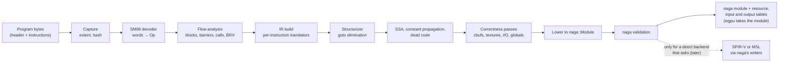

# Shader pipeline

Status: approved by the owner, 2026-11-12 (issue #13).

Every item in "Decisions for the owner" carries the owner's ruling (`docs/decision-log.md`,
2026-11-12), and the text follows them and the seam resolutions of the graphics review guide
(`docs/specs/graphics-review-guide.md`).

`crates/shader` turns the guest's GPU programs into host shaders. A Switch 2 game ships its
shaders as compiled NVIDIA machine code (SASS for the SM86 shader model, 128-bit instructions;
`switch2-eden-diff-scoping.md`, "Shaders"). The host GPU cannot run that code, so starquake
decodes it, rebuilds its control flow, translates it into an intermediate representation (IR),
applies the passes correctness needs, and lowers it to a validated `naga` module. The render
backend's first host layer is wgpu, which takes that module directly (owner's decisions of
2026-11-12). Final SPIR-V or MSL is emitted here, with naga's writers, only for a later direct
backend that asks for it. The GPU crate asks for shaders on its back thread and carries the
result to the render backend, which builds pipelines from it.

## Summary

- **Native from the start.** Both Eden-based Switch 2 efforts lower SM86 to Maxwell code so that
  Eden's old decoder can take it (scoping doc, row 54); PR #4588 adds an opt-in native frontend.
  Starquake decodes SM86 directly, with encodings ported from Mesa NAK (MIT) and behaviour
  checked against PR #4588's native frontend and its tests.
- **Our own IR, Eden's semantics** (decided by the owner, decision 1). A new arena-based Rust IR
  whose operations and passes follow Eden's `shader_recompiler` IR (SSA, structured control
  flow), with instructions in arenas referred to by typed ids, its own register class for
  uniform registers, a text form and a verifier. Eden's passes are ported by behaviour, not line
  by line, and the IR is not a direct lowering to naga's IR.
- **naga is the only shader backend at first, and the output is a naga module** (decided by the
  owner, decisions 2 and 3). The crate hands out a validated naga module plus tables of its
  resources, inputs and outputs. The wgpu render backend takes the module directly; a later
  direct backend asks for final SPIR-V or MSL, which this crate writes with naga's writers. naga
  validates every module, is pure Rust, and in version 30 already has mesh and task stages. It
  cannot express several things the guest does (geometry and tessellation stages, transform
  feedback, texture LOD queries, sparse residency, raw pointers, among others: the gap table
  below), but wgpu cannot run the missing stages either. Each gap has a stated plan, and the IR
  does not depend on naga, so a direct SPIR-V or MSL writer can be added for a gap without
  touching the rest. naga is pinned to the version wgpu uses.
- **Translation is a pure function of explicit inputs.** The program bytes, a short list of
  answers about engine state (constant-buffer words, texture kinds) and a variant key are the
  whole input. Nothing reads live GPU state while translating, so translation runs on worker
  threads and its output can be cached by key, on disk too. Eden-NX2 could not move translation
  to workers for exactly this reason (row 121).
- **Everything is tested offline.** Per-instruction fixtures with expected disassembly ported
  from NAK's `nvdisasm` tests, an IR interpreter as the semantic oracle, naga validation of every
  module handed out, and golden IR text. No game, no GPU and no `nvdisasm` needed in CI. That
  wgpu accepts the modules is checked locally on a Mac, and in Linux CI on lavapipe if the render
  backend's lavapipe experiment passes (render-backend, decision 9).

Facts below cite a scoping-doc row (the row numbers are Eden-NX2's `NX2_NOTES.md` rows), a
reference path relative to the reference folder with its commit (`docs/references.md`), or are
marked as guesses with what would confirm them. Commits: `eden` `cf654052`, `eden-nx2`
`50fa86bb`, `eden-pr4588` `e5fb3b97`, `mesa-nouveau` `52238762`. naga facts are from the
published crate `naga` 30.0.1 (crates.io, 2026-08-22, MIT OR Apache-2.0), read from source; the
experiments in "What to verify before building" confirm them.

## Terms

| Term | Meaning |
|---|---|
| SASS, SM86 | NVIDIA's GPU machine code; SM86 is the Ampere shader model the Switch 2 uses |
| Program | One guest shader: optional header plus a run of 16-byte instructions in guest memory |
| SPH | Shader program header, in front of graphics programs: stage, inputs and outputs used, local memory size |
| cbuf | Constant buffer: guest memory bound to a numbered bank (slot) for a stage |
| TIC, TSC | Texture header and sampler descriptor tables in guest memory; a texture handle indexes them |
| GPR, UR, P, UP | Per-thread registers R0–R254 (R255 reads zero), uniform registers UR0–UR62, predicates P0–P6 (P7 is true), uniform predicates UP0–UP6 |
| Variant key | The part of the 3D engine's state a translated shader depends on |
| naga | The shader translator from the `wgpu` project; we hand out its IR (a `naga::Module`), and use its SPIR-V and MSL writers only for a later direct backend |

## Where programs come from

**Graphics.** The Ampere 3D class has one slot per pipeline stage. `SET_PIPELINE_SHADER(j)`
enables the slot and gives its type (vertex-cull-before-fetch, vertex, tessellation init,
tessellation, geometry, pixel), and `SET_PIPELINE_PROGRAM_ADDRESS_A/B(j)` give a 40-bit program
address (`mesa-nouveau/src/nouveau/headers/nvidia/classes/clc797.h`: methods `0x2000 + j*64`,
`0x2014 + j*64`, `0x2018 + j*64`). On Switch 2 a GPU address equals the CPU address (row 30), so
the program is read from guest memory at that address. A graphics program starts with a 128-byte
header (SPH version 4): NAK writes 32 words of header for SM 7.3 and later
(`mesa-nouveau/src/nouveau/compiler/nak/sph.rs`, `SPHV4_SHADER_HEADER_SIZE`), and PR #4588 skips
128 bytes before the first instruction of a graphics program
(`eden-pr4588/src/video_core/shader_environment.cpp`, `InitializeNativeCode`). Its field layout
is in `mesa-nouveau/src/nouveau/headers/nvidia/classes/clc797sph.h` (MIT).

**Compute.** A dispatch is described by a QMD (version 3.0 on Switch 2; scoping doc, "GPU command
stream"), which gives the program address, the workgroup size, the shared-memory size and the
constant buffers (`clc7c0qmd.h`: `QMDV03_00_PROGRAM_ADDRESS_LOWER/UPPER`,
`CTA_THREAD_DIMENSION0..2`, `SHARED_MEMORY_SIZE`, `CONSTANT_BUFFER_ADDR_*`). A compute program
has no header: PR #4588 passes a header size of 0 for compute (`shader_environment.cpp`, the
compute environment's call to `InitializeNativeCode(0, ...)`).

**Where a program ends.** Nothing records a program's length. The capture step reads
instructions until it reaches an `EXIT` that is unconditional and lies past every forward branch
target seen so far, and past every `CALL` target and its `RET` (PR #4588,
`frontend/ampere/program_capture.h`, `ProgramCaptureState::Observe`). Rules learned the hard
way, all to be kept:

- `CALL.REL.NOINC` is a forward branch, not a call (row 67).
- A `BRX` jump table lives in a constant buffer and its targets may lie past the first `EXIT`;
  the capture is extended through them (row 92; `program_capture.h`,
  `ResolveCaptureIndirectBranches`).
- Library functions may `EXIT`, and `RET` may restore its link register through code in between
  (row 88).
- A cap of 65,536 instructions (`program_capture.h`, `MaximumInstructions`). A program that
  reaches it, or a branch outside it, is rejected.
- The scan is linear in the program's length. A quadratic search cost 3.4 s on one
  28,102-instruction shader (row 121).

**Instruction layout facts used before full decoding.** The opcode is bits 0–11
(`frontend/ampere/isa.h`, `LookupRow`), the guard predicate bits 12–15 with 7 meaning "always"
and bit 3 negating it (`frontend/ampere/trap_guards.h`), relative branch offsets are a signed
count of 32-bit words starting at bit 34 (`frontend/ampere/instruction.h`), and bits 105–127 carry
scheduling information that every row of PR #4588's decode table treats as known
(`isa.h`, `FirstUnknownBit`). Starquake ignores the scheduling bits: they encode stalls and
dependency barriers, which NAK computes for timing only (`nak/calc_instr_deps.rs`). That they
never change results is a guess that the fixture corpus and `nvdisasm` output would expose if
wrong.

## Identity, caching and invalidation

Three layers, cheapest first:

1. **Address map:** `(stage kind, program address)` → content hash. Valid until any byte of the
   program's captured range is written or unmapped. Looked up on every draw that changes a
   program, on the GPU back thread, without locks on the hot path (a generation counter per
   entry, bumped by invalidation).
2. **Program entries:** content hash → the decoded, structured, stage-independent IR and the
   list of questions it asks about engine state (below). The hash covers the header and every
   captured instruction byte, so a program moved to another address, or rewritten with the same
   bytes, is found again.
3. **Shader entries:** `(content hash, answers, variant key, host target, translator version)` →
   the host shader. The host target says which form the backend wants (a naga module for wgpu;
   SPIR-V or MSL for a later direct backend) and what the device supports. The translator
   version is a constant bumped on any change to translation output, as PR #4588 does with
   `NATIVE_TRANSLATOR_SALT` (`frontend/ampere/native.h`).

**Invalidation.** The cache offers `invalidate(range)`, and the GPU crate's back thread is its
only caller (review guide, M7). The back thread calls it for CPU writes it drains from write
tracking (the `WriteWatch` dirty log in `starquake-memory`, gpu-protocol "Learning of CPU
writes"; an implied change to `specs/execution-model.md`, "Write tracking for the GPU caches",
listed for the owner), for GPU-side writes (DMA, inline-to-memory, shader stores), and for
unmaps and frees of GPU memory, which games reuse as heap (row 68). Unmaps reach the GPU crate as
ordered updates of its address table, which carry the range (`GpuFront::update_vm`). Invalidation
only drops address-map entries; program and shader entries are content-addressed and stay until
evicted, so the same bytes written back cost a hash, not a translation. Registering ranges for
write tracking is the GPU crate's job; the cache reports which ranges it depends on.

**Negative cache.** A rejected program is remembered with its reason and not translated or
logged again until its memory is written (rows 90, 112). The reason names the first unsupported
instruction and its index, and the rejection is counted once in the run's summary.

**Hash.** A fast non-cryptographic 128-bit hash of the bytes (the exact function is a slice
detail; it must be stable across runs and platforms because the disk cache uses it). Collisions
are treated as impossible at 128 bits; the disk cache stores the bytes anyway (below), so a
collision can be checked for when an entry is loaded.

## Translation inputs: questions and answers

Eden's `Environment` lets translation read live engine state at any time: constant-buffer
values, texture types, texture formats (`eden/src/shader_recompiler/environment.h`). That ties
translation to the GPU thread and to the moment of the draw. Starquake replaces it with an
explicit exchange:

1. Translating a program (layer 2) produces, besides the IR, a list of **questions**:
   - `CbufWord { bank, offset }`: a constant-buffer word the shader's structure depends on, such
     as a `BRX` jump table entry (rows 91, 92) or a texture handle the shader loads from a
     constant buffer.
   - `TextureKind { handle }`: what a texture handle points to: sampled component type (float,
     signed, unsigned), whether it is a depth format, multisampled, a buffer texture, and the
     format of a storage image used by a formatted surface load or store (rows 83, 86).
2. The GPU back thread **answers** them from current engine state. Answers are small (tens of
   words) and cheap to compute.
3. Specialising the IR with the answers and the variant key (layer 3) is again pure.

A question can depend on an earlier answer (a jump table found only once another table is
known), so the exchange may take more than one round; it is capped at a small fixed number of
rounds (four is a guess; experiment E6 measures it), after which the program is rejected. On a
later draw the back thread re-answers the same list and looks up layer 3 with the result, so a
shader that depends on a constant-buffer value is retranslated only when the value changes.

The answers and the variant key are recorded with each shader entry. That is also what the disk
cache and a local shader capture store, so a translation can be replayed offline exactly.

## The translation pipeline



### The SM86 decoder

**Shape.** The decoder turns one 128-bit word into an `Op`: an enum with one variant per
instruction (`FAdd`, `IAdd3`, `Tex`, `Bssy`, ...), each a struct of typed operands (register,
uniform register, predicate, constant-buffer reference, immediate) and modifiers. The variants
follow NAK's `Op*` structs (`mesa-nouveau/src/nouveau/compiler/nak/ir.rs`), which are a decoded
instruction model in Rust already; porting their shape with attribution saves inventing one.

**Where encodings come from.**

| Source | What it gives | Licence |
|---|---|---|
| NAK `sm70_encode.rs` | Field layouts for 94 instructions on SM 7.0 and later, as an encoder (`impl SM70Op for Op...`) | MIT; port with attribution |
| NAK `nvdisasm_tests.rs` | 19 tests pairing NAK instructions with the exact `nvdisasm` text, written to run for every shader model in its `sm_list`, which includes SM86 for both CUDA 12 and CUDA 13 `nvdisasm` | MIT |
| PR #4588 `frontend/ampere/ampere_isa_table.h` | 629 decode rows (112 mnemonics) with a "known bits" mask each, generated from NAK's field map by a script that is not in the references. Covers what NAK lacks: `CALL`, `RET`, `BRX`, `BRXU`, `DEPBAR`, `P2R`, `R2P`, `UMOV`, `ULDC.64`, `LDGSTS`, the `.UR` texture forms | GPL-3.0-or-later; port with attribution |
| PR #4588 `frontend/ampere/ops_*.cpp`, `flow.cpp` | Field reads for every form its native frontend accepts | GPL-3.0-or-later |
| `nvdisasm` | The vendor's own decoding, for any word | Proprietary tool; never a dependency; output used as a test oracle where a developer has it |

NAK only encodes what NAK's compiler emits, so its tables are an inverse of what we need and
miss forms that NVIDIA's compiler produces. The decoder is written as the inverse of NAK's
encoder for the 94 instructions NAK has, and from PR #4588's rows and field reads for the rest.
An encoding from the PR alone is marked in a comment as needing an `nvdisasm` check until a
developer with the tool has run it.

**Strict decoding.** Each decode form carries a mask of the bits it explains. An instruction
with a set bit outside its form's mask is rejected as unknown, not decoded with the bit ignored
(PR #4588 does the same: `isa.h`, `FirstUnknownBit`). A misread modifier would produce a shader
that compiles and renders wrongly, which is far more expensive to find than a rejection.

**Test assembler.** A test-support assembler, ported from NAK's encoder, builds instruction
words from `Op` values. It is the fixture generator for every other test in the crate (the
alternative, hex words copied from real shaders, cannot be committed). Because the assembler is
a mechanical port of an encoder that Mesa checks against `nvdisasm`, and the decoder is written
separately as its inverse, a round-trip test between them is not two agents agreeing with
themselves; the expected-text tests below close the remaining gap.

**Disassembler.** The decoder has a printer that writes the same text as `nvdisasm` (lower-cased,
as NAK's tests compare it). It serves the expected-text fixtures, the IR golden files and
rejection messages.

### Control-flow recovery

SM70 and later replaced Maxwell's `SSY`/`SYNC`/`PBK`/`BRK` stack with convergence barriers:
`BSSY Bn, target` records where threads reconverge and `BSYNC Bn` waits there; `BREAK`, `BMOV`
and `WARPSYNC` manipulate the barriers; `CALL`/`RET` are real subroutine calls; `BRX` and `JMX`
are indirect branches.

Flow analysis, ported from PR #4588 (`frontend/ampere/flow.cpp`, `flow.h`):

- Splits the captured program into basic blocks and records reachability from the entry.
- Pairs each `BSYNC` with its reconvergence point. PR #4588 implements two models, a strict
  `BSSY`/`BSYNC` stack and a barrier-register model, and tests that they agree
  (`AnalyzeFlowStack`, `AnalyzeFlowRegisters`); starquake ports both for the same check and
  uses the register model.
- Treats each `CALL` target as a function and inlines it at every call site. Recursion is
  rejected.
- Resolves `BRX` targets from the jump-table answers (questions above). Table entries that are
  not instruction addresses inside the capture are ignored; a `BRX` with no valid target is
  rejected.
- Runs in time linear in the program's size (row 121).

**Structuring.** naga, like SPIR-V and MSL, needs structured control flow: `if`, `loop`,
`switch`, `break`, `continue`, no `goto`. The structurizer is a port of Eden's goto-elimination
pass (`eden/src/shader_recompiler/frontend/maxwell/structured_control_flow.cpp`), which turns
an arbitrary control-flow graph into structured statements by adding flag variables. It already
handles everything Maxwell code does; SM86 adds only different branch instructions, which flow
analysis turns into plain edges first. Divergence (threads of a warp taking different paths) is
not modelled: host shaders run each invocation independently, and reconvergence points become
the ends of structured regions.

### The intermediate representation

The IR is designed for this crate and borrows Eden's operation set and pass semantics
(`eden/src/shader_recompiler/frontend/ir/opcodes.inc`, `ir_opt/`). Decision 1 explains why.

- **Storage:** functions own arenas of blocks and instructions; values are typed ids
  (`Value(u32)`), not pointers. Deterministic iteration everywhere (ids in creation order,
  `Vec`s, `BTreeMap`s where a map is needed), so the same input always prints the same IR.
- **Before structuring:** a control-flow graph of basic blocks; guest registers are read and
  written with `GetReg`/`SetReg`, `GetPred`/`SetPred`, and the uniform equivalents, as Eden
  does.
- **After structuring:** a tree of structured statements over blocks.
- **SSA:** register accesses are rewritten into SSA values with Eden's algorithm (Braun et al.,
  `ir_opt/ssa_rewrite_pass.cpp`).
- **Types:** `U1` (predicate), `U32`, `U64`, `F16x2`, `F32`, `F64`, and small vectors for
  texture coordinates and results, as in Eden's `frontend/ir/type.h`.
- **Operations:** arithmetic and conversions with explicit modifiers (saturate, flush-to-zero,
  rounding mode) carried even where the backend cannot honour them yet; memory accesses by
  space (constant buffer, global, local, shared); texture and image operations with a resource
  reference; attribute loads and stores; barriers, subgroup operations, `Kill`/`Demote`.
- **Text form:** a printer, and a parser for test input, so golden files are readable and a pass
  can be tested from hand-written IR.
- **Verifier:** checks types, SSA dominance and structure after every pass in debug builds and
  in tests (Eden's `ir_opt/verification_pass.cpp`).
- **Passes are ported by behaviour,** not line by line: each keeps Eden's result on the same
  input, checked by golden IR and by the interpreter (decision 15), over the arena layout.

**Uniform registers** get their own register class in the IR. PR #4588 packs them into the top
of Maxwell's register file to fit Eden's IR (`native.h`, `UniformLayout`), with fallbacks for
programs that use high registers; a native design does not need that.

### Instruction translation

One translator per instruction group turns a decoded `Op` into IR, honouring the guard predicate
(an instruction under a predicate becomes a conditional block). The translators are ports of PR
#4588's native frontend (`frontend/ampere/ops_alu.cpp`, `ops_int.cpp`, `ops_float.cpp`,
`ops_half.cpp`, `ops_convert.cpp`, `ops_memory.cpp`, `ops_texture.cpp`, `ops_attr.cpp`,
`ops_misc.cpp`, `ops_move.cpp`), cross-checked against Eden's Maxwell translators for the same
operation (`frontend/maxwell/translate/impl/`). Semantics that changed from Maxwell and must
not be copied from Eden's Maxwell code:

- `MUFU.SIN`/`MUFU.COS` take their argument in turns, not radians (row 95).
- 64-bit integer arithmetic is built from carry chains (`IADD3.X`, `UIADD3` with a carry-out
  predicate), which the IR expresses as 64-bit operations once recognised (scoping doc, "Missing
  pieces in the lowering"; rows 63, 83).
- Uniform datapath forms (`UIMAD.WIDE`, `USHF`, `UFMNMX`, `UI2F`, `UF2I`, `ULOP3` with a
  predicate output, `UP2UR`) and `PLOP3`/`UPLOP3` with any truth table (row 88).

An instruction a translator does not handle produces a rejection naming it; there is no partial
translation.

### Passes needed for correctness

In order (following Eden's order in `frontend/maxwell/translate_program.cpp`, lines 378–409):

1. **SSA rewrite, identity removal, constant propagation** (Eden's passes of the same names).
2. **Constant buffers.** Every constant-buffer read becomes a read from a host binding for that
   bank. Reads with a register offset (indexed) are bounds-checked against the bound size.
   Banks are a 5-bit field in the instruction (`trap_guards.h` reads the bank of an ALU
   constant-buffer operand from bits 54–58), and the
   console binds bank 24 itself for blit passes (row 65), so the host model has 32 bank slots,
   not Eden's 18 (`eden/src/video_core/engines/maxwell_3d.h`, `MaxConstBuffers`). Supplying
   bank 24's contents is the GPU crate's job.
3. **Textures and samplers.** Each texture instruction's handle is traced back to where it came
   from: an immediate offset into the bound texture constant buffer (bound textures), or a
   register whose value was loaded from a constant buffer (bindless). Port of Eden's
   `ir_opt/texture_pass.cpp` with PR #4588's changes. The result is a list of texture
   descriptors (where to find the handle, the dimension from the instruction, the component
   type from the `TextureKind` answer) that becomes the shader's resource table. A handle that
   cannot be traced is a rejection: handles are traced first, and true bindless comes only after
   a survey of titles shows it is needed (decision 8).
4. **Global memory.** `LDG`/`STG`/`ATOMG`/`RED` take 64-bit addresses. Eden's
   `ir_opt/global_memory_to_storage_buffer_pass.cpp` traces an address back to a pointer stored
   in a constant buffer and turns the access into a storage-buffer access; the buffer is bound
   per draw from the constant buffer's value. Ported as is, with the linear-time fix of row
   121. An address that cannot be traced is a rejection at first; this is revisited when a
   direct backend can share memory (decision 9).
5. **Inputs and outputs.** Attribute loads and stores (`ALD`, `AST`, `IPA`, `OUT`), system
   values (`S2R`, `CS2R`) and pixel outputs map to host inputs, outputs and built-ins. The SPH
   says which attributes a stage reads and writes, its interpolation modes, and which colour
   targets a pixel program writes (its registers at `EXIT` hold the colours, as in Eden's
   `frontend/maxwell/translate/impl/exit_program.cpp`). Port of Eden's `frontend/ir/attribute.h`
   and the attribute parts of `ir_opt/collect_shader_info_pass.cpp`, with the SPH v4 layout.
6. **Local and shared memory.** Local memory becomes a private array sized from the SPH
   (graphics) or the QMD (compute); shared memory a workgroup array sized from the QMD. All
   indexed accesses are bounds-checked.
7. **Dead code elimination**, then **collect info**: the resource table, the interface, and the
   host features the shader needs.
8. **Host lowering passes**, only where the target needs them: f64 to f32 on Metal, which has no
   64-bit float (Eden's `ir_opt/lower_fp64_to_fp32.cpp`; Metal fact from the Metal Shading
   Language specification, not re-checked for this draft), and f16 to f32 where the host lacks
   16-bit arithmetic (`lower_fp16_to_fp32.cpp`).

Deliberately not ported: Eden's rescaling pass (resolution scaling, a later feature), its vendor
workarounds, and everything in PR #4588's `lower_to_maxwell.h`.

### The backend through naga

The structured, specialised IR is lowered to a `naga::Module` and validated with
`naga::valid::Validator`. The module and its `ModuleInfo` are what the crate hands out (owner's
decision of 2026-11-12): the GPU crate carries them to the render backend, whose wgpu backend
gives the module to wgpu, which writes the final code for its own host API on its safe, checked
path. Only when a later direct backend asks for final code (it says so in the `HostTarget` it
gives the cache) does this crate also write the module with naga's SPIR-V or MSL writer, with
that backend's binding map and bounds-check policy. That writer step is not built until such a
backend is scheduled (slice 22).

The lowering module (and later the writer module) is the only code that builds or writes naga
IR, because naga's major version changes about every three months (28.0.0 in 2025-12, 29.0.0 in
2026-03, 30.0.0 in 2026-07, from crates.io) and each upgrade should touch one place. The GPU and
render crates only move the finished module. The version is pinned exactly, to the naga version
wgpu itself depends on, so that the shader, gpu and render crates share one naga (owner's
decision of 2026-11-12); upgrading naga therefore means upgrading wgpu with it. The gate could
check that the lock file has a single naga (a proposal, not yet a gate step).

Validation runs with the uniformity check off: the guest computes derivatives inside divergent
control flow, which NVIDIA hardware allows (`naga::valid::ValidationFlags::CONTROL_FLOW_UNIFORMITY`
exists so it can be turned off). **Open:** wgpu validates a module it is given again, with its
own flags. If it runs the uniformity check, it would reject such shaders. Whether it does, and
whether a diagnostic filter carried in the module can turn that check off, is to be settled by
experiment E1 before slice 1; if neither holds, guest shaders that take derivatives in divergent
control flow need another route (an upstream change, or a different wgpu entry point).

**What naga 30.0.1 can express**, from its IR source (`naga/src/ir/mod.rs`,
`naga/src/valid/mod.rs`, `naga-types/src/lib.rs`), to be confirmed by experiment E1:

| Feature | naga 30.0.1 | Plan |
|---|---|---|
| Vertex, pixel, compute stages | Yes | Use |
| Task and mesh stages | Yes: IR, MSL `[[object]]`/`[[mesh]]`, SPIR-V `MeshShadingEXT`. The render draft's wgpu table says naga cannot emit them for Metal; E1 settles which is right (review guide, M12). wgpu's mesh support is experimental | Use when mesh work starts (deferred) |
| f16, i64, f64, 64-bit atomics, image atomics | Yes, behind capabilities | Use; Metal lacks f64 (lowering pass) |
| Subgroup ballot, vote, shuffle, quad operations | Yes | Use for `VOTE`, `SHFL`, `MATCH`, `REDUX`, `FSWZADD`; needs a subgroup size of 32 |
| Binding arrays with non-uniform indexing | Yes | Use for bindless (decision 8) |
| Barycentrics, dual-source blending, early depth test, clip and cull distances | Yes | Use |
| Geometry and tessellation stages | **No** (`ShaderStage` has no such variants); wgpu has no such stages either | Deferred until a direct Vulkan backend; decision 13 |
| Transform feedback | **No** | Deferred |
| Layer and viewport index written by a vertex stage | **No** (`BuiltIn` has `ViewIndex` only) | Upstream to naga, or direct writer |
| Stencil reference export | **No** | Upstream or direct writer |
| Texture LOD query (`TMML`, row 63 and the notes' "Open" list) | **No** (`ImageQuery` is size, levels, layers, samples) | Upstream or direct writer |
| Non-constant texel offsets; four per-texel gather offsets (`TLD4` with offsets) | **No**: the offset "must be a const-expression" and is single | Emulate in IR (offset coordinates by hand) |
| Minimum-LOD clamp on a sample | **No** (`SampleLevel` has no clamp) | Emulate in IR where exact; else ignore and list |
| Interpolation at an offset or a sample (`IPA` modes, rows 83, 86) | **No**: only fixed qualifiers (center, centroid, sample) | Upstream or direct writer |
| Sparse residency (`.SPARSE` texture results) | **No** | Report "resident" and list the divergence |
| Pointers made from integers (untraced global memory) | **No**: no physical-storage address space | Decision 9 |
| Per-instruction rounding mode, flush-to-zero | **No** | Decision 10 |
| Demote to helper versus terminate | `Kill` only ("Aborts the current shader execution") | Use `Kill`; list the divergence; confirm in E1 |

So naga covers the first milestone (vertex, pixel and compute shaders doing arithmetic, constant
buffers, textures and attributes) and leaves a known list for later. Decision 3 covers how the
gaps are closed.

## Pipeline-state specialisation

The **variant key** is the part of 3D engine state that changes the translated code. It is
built by the GPU crate and kept as small as possible, because every distinct key is another
compilation (a stutter on first use). From Eden's `runtime_info.h` (`RuntimeInfo`), what a
shader on a wgpu, Vulkan or Metal host has to be specialised on:

- Vertex stage: the component type of each vertex attribute (float, signed, unsigned, scaled).
- Pixel stage: the component type of each colour target; whether dual-source blending is on.
- Every stage that feeds another: which outputs the next stage reads (interface matching).
- Compute: workgroup size (naga needs it as a constant in the entry point) and shared-memory size.

Two groups of fields come from the render backend, through the GPU crate, because only the
render backend knows what the host lacks (review guide, M13):

- **The render backend's `EmulationFlags`**, decided by its pure `emulation(&Caps, &state)` and
  copied field by field into the key by the GPU crate: alpha test function (Maxwell-class engines
  have alpha test; wgpu, Vulkan and Metal do not, so it becomes code; the reference value is not
  in the key), the depth-range rewrite and viewport origin where the host cannot express them as
  state, fetching vertex attributes beyond the host's limit from a storage buffer, typed colour
  outputs, and primitive-restart index handling where it is done in the shader. The render crate
  decides this list; the shader crate cannot see its types (no dependency), so the key mirrors
  them and a GPU-crate test checks every flag is copied.
- **Texture component swizzles.** The guest's texture headers carry a per-texture swizzle. wgpu
  has no per-view swizzle, so the render backend reports `Caps::view_swizzle = false`, and the
  GPU crate then puts the swizzle of each texture binding into the key; the lowering applies it
  to sampled and loaded results. With a direct backend that swizzles in the view, the field
  stays empty. This is an exception to decision 16's "types and structure only", required by
  the owner's decision 1 (wgpu first), whose reasoning names it.

**Values go in driver constants, not in the key.** Anything that is a number rather than a
structural choice (the alpha reference, the viewport flip, the render-area size behind bank 24
of row 65, base vertex and instance offsets) is read by the shader from a small per-draw uniform
block, the **driver constants**, whose layout the shader crate defines and versions, and the GPU
crate fills. Each new specialisation needs a reason in its PR.

## Compilation, threads and stutter

- **Lookups are on the GPU back thread** and never translate: a lookup returns the shader, a
  rejection, or a pending ticket.
- **Translation runs on compile workers** (the "shader compile workers" of
  `docs/architecture.md`). The shader crate does not own threads. `core` creates one compile
  pool and hands it to both this crate and the render backend, so translation and pipeline
  compilation share one set of threads, sized in one place (review guide, M16). The crate takes
  the pool through its own small executor trait, which `core` implements.
- **Duplicate requests coalesce:** a second request for a shader already being translated waits
  on the same ticket.
- **What a draw does on a miss** follows one wait-while-compiling setting owned by the GPU crate,
  which covers translation and pipeline builds alike (review guide, M10): wait for the ticket
  (exact, deterministic, stutters) or skip the draw (smooth, wrong frames, nondeterministic).
  The default is to wait; skipping becomes an opt-in setting once the persistent caches exist
  (decision 6).
- **The persistent cache** stores, per shader entry, the inputs only: the program bytes, the answers
  and the variant key, under a header with a magic, a format version and the translator version
  (decision 7). It does not store translated naga modules, whose serialised form moves with each
  naga version. Its key and format are defined now (slices 9 and 20); the cache itself is built
  after milestone 3. At start-up, entries for the running title are retranslated on workers before
  the first draw needs them (2–4 ms per shader, row 121's numbers). The shader crate serialises and
  deserialises entries; it does no file I/O itself (the core crate owns the folder). The file is
  derived from a game and lives in the user's data folder, never in the repository
  (`specs/observability.md`, "Storage and what may be committed"). Host pipeline binaries (wgpu's
  pipeline cache where it exists, Vulkan pipeline caches, Metal binary archives) are the render
  backend's and sit next to it.
- **Translation time is a budget, not an afterthought:** every stage is linear or close to it in
  the program size, and a test translates a large synthetic program (tens of thousands of
  instructions) within a fixed time on CI (row 121's shader took 3.4 s with a quadratic search,
  0.85 s after the fix, and NX2 measured 2–4 ms for typical runtime builds).

## Compute shaders

Compute programs go through the same pipeline with three differences: no header (the QMD gives
local memory, shared memory and workgroup size); constant buffers come from the QMD instead of
3D engine bindings; and the variant key holds the workgroup size and shared-memory size. Warp
instructions assume 32 lanes, so compute and every other stage that uses subgroup operations
records "needs subgroup size 32" in its requirements (Apple GPUs run 32-wide SIMD groups; AMD
hosts must request it; render backend's concern).

A compute program that is rejected must still let its dispatch complete and fire its QMD
releases, or queues waiting on it hang (row 61). That is the GPU crate's job; the shader crate's
part is to return a rejection quickly and never block.

Tensor-core instructions (`HMMA`, `IMMA`, `LDSM`, `MOVM`) are decoded but not translated at
first; a program that uses them is rejected (row 64 shows such a network takes minutes for a
host driver to compile when emulated naively).

## Untrusted input

Program bytes, header fields, constant-buffer words and descriptor contents are all written by
the guest. The rules of `CLAUDE.md` apply in full:

- The decoder, capture, flow analysis and translators return `Err` on anything malformed, never
  panic: every one of them has a property test over arbitrary input.
- Branch targets, jump-table entries and `CALL` targets are validated against the captured
  program, not just against a range.
- Register numbers, bank numbers, attribute offsets and memory offsets are checked against their
  limits; indexed accesses in the module handed out are bounds-checked so a guest index cannot
  read outside a host binding. wgpu adds its own checks when it writes the final code (owner's
  decision of 2026-11-12); a direct backend states its bounds-check policy in its `HostTarget`.
- Every limit (instruction cap, question rounds, inlining depth, structuring work) has a test at
  the edge on both sides.

## The offline test harness

Everything here runs in CI with no game, no GPU and no `nvdisasm`.

| Test | Oracle | Runs |
|---|---|---|
| Decoder expected text | `nvdisasm` text from NAK's `nvdisasm_tests.rs` (MIT), ported as fixture tables: build the word with the test assembler, decode it, print it, compare with the recorded text | Every gate |
| Decoder round trip | Test assembler (ported encoder) → decoder → assembler gives the same word, for generated `Op` values (proptest, fixed seed) | Every gate |
| Strict decoding | For each form, flipping any bit outside its mask makes the decoder reject the word | Every gate |
| Decoder robustness | Arbitrary 128-bit words never panic | Every gate; also a fuzz target |
| `nvdisasm` cross-check | A developer with `nvdisasm` runs `cargo xtask shader-nvdisasm`, which disassembles every committed fixture word one instruction at a time (row 88: one bad word stops `nvdisasm`) and rewrites the expected-text files; the diff is reviewed and committed with the tool version recorded | By hand, when encodings change |
| Translator semantics | An IR interpreter executes the translated IR for one instruction (or a short sequence) on given register, predicate and constant-buffer values; results are compared with values derived from the instruction's documented behaviour. PR #4588's tests do the same against Eden's IR (`tests/video_core/native_shader.cpp`, 271 test cases, its `EvaluateVertex`) and are ported as cases | Every gate |
| Flow and structuring | Synthetic programs from the test assembler (nested barriers, early exits, calls, jump tables, loops with breaks), checked against golden IR text and by running them in the interpreter | Every gate |
| Passes | Hand-written IR in, golden IR out (insta snapshots, each change explained in its PR as `specs/testing.md` requires) | Every gate |
| Module validity | Every module the lowering produces in any test passes `naga` validation, with the flags this crate uses and, once E1 says what they are, the flags wgpu uses | Every gate |
| End to end | Synthetic vertex/pixel pairs and compute programs, assembled in tests, go from bytes to a validated naga module and its tables (golden tables) | Every gate |
| wgpu acceptance | The end-to-end modules are created as shader modules and pipelines on a wgpu device | Locally on a Mac (wgpu on Metal); in Linux CI on lavapipe if the render backend's lavapipe experiment passes (its decision 9), else locally only, like the hypervisor tier |
| Final code (later, slice 22) | For a direct backend: emitted SPIR-V read back with naga's SPIR-V frontend and checked with `spirv-val` where installed; MSL compiled with Apple's `metal` compiler on a Mac; MSL goldens | When a direct backend is scheduled |
| Title coverage | `cargo xtask shader-replay <folder>` re-translates local shader captures (program bytes plus answers, recorded from a title run) and prints a histogram of rejections by instruction, like Eden-NX2's offline lowering test (row 54) | Locally only; captures never committed |
| Speed | A large synthetic program translates within a fixed bound | Every gate |

Committed fixtures are synthetic: built by the test assembler from `Op` values, or hand-written
IR. Hex words copied out of PR #4588's tests are used only where their origin is synthetic;
where a word may come from a game's shader, the case is rebuilt with the test assembler instead.
The shader capture format (local only) has a golden-bytes test of its own and a version.

## Interfaces to neighbouring designs

The four graphics drafts were amended together on 2026-11-12 so that every shared type and call
below has the same name in each. Types are sketches; field names may change, the split should
not.

### The crate's place

`gpu` depends on `shader` and on `render`; `shader` depends on neither (`CLAUDE.md`,
"Architecture rules": `gpu` → `shader`, `render`). The shader crate's output is a naga module
plus plain-data tables, and the GPU crate carries it to the render backend (owner's decision of
2026-11-12). The shader crate depends on `naga`, at the version wgpu uses, and on nothing of ours
except possibly `trace` for its events. Game memory addresses stop at the GPU crate.

### What the GPU front/back protocol and engine state (#12) gets

```rust
/// Created once by the core crate with the host target and the shared compile pool.
pub struct ShaderCache { /* ... */ }

pub enum GuestStage { VertexCullBeforeFetch, Vertex, TessellationInit, Tessellation, Geometry, Pixel, Compute }

/// What the back thread asks for, per stage slot or per dispatch.
pub struct ProgramRequest { pub stage: GuestStage, pub address: u64 }

/// Read access to guest memory at GPU addresses (equal to CPU addresses on Switch 2).
/// Implemented by the GPU crate over its address table.
pub trait ProgramMemory { fn read(&self, address: u64, out: &mut [u8]) -> Result<(), Unmapped>; }

/// Answers questions from current engine state, on the back thread. Implemented by the GPU crate.
pub trait EngineState {
    fn cbuf_word(&self, stage: GuestStage, bank: u8, offset: u32) -> Option<u32>;
    fn texture_kind(&self, stage: GuestStage, handle: u32) -> Option<TextureKind>;
}

impl ShaderCache {
    /// Never blocks and never translates. Reads program bytes on a miss of the address map.
    pub fn lookup(&self, req: &[ProgramRequest], variant: &VariantKey,
                  mem: &dyn ProgramMemory, state: &dyn EngineState) -> Lookup;
    /// Called by the GPU back thread only; cheap.
    pub fn invalidate(&self, range: core::ops::Range<u64>);
    /// Ranges the cache depends on, for the caller to write-track.
    pub fn tracked_ranges(&self) -> Vec<core::ops::Range<u64>>;
}

pub enum Lookup { Ready(Arc<ShaderSet>), Pending(Ticket), Rejected(Arc<Rejection>) }
```

Assumed of #12 (gpu-protocol now assumes the same; review guide, M9):

- The back thread calls `lookup` when a stage's program address or the variant key changes, and
  decides what a draw does while a ticket is pending, through its one wait-while-compiling
  setting (decision 6).
- It builds the `VariantKey` from 3D engine state, copies in the render backend's
  `EmulationFlags`, and, when the render backend's `Caps::view_swizzle` is false, each texture
  binding's swizzle. It fills the driver constants each draw.
- It implements `ProgramMemory` (over its address table, `GpuVm`) and `EngineState`.
- It calls `invalidate` from the back thread: for CPU writes drained from `WriteWatch`, for
  GPU-side writes, and for unmaps and frees, which reach it as ordered address-table updates
  carrying the range. It registers `tracked_ranges` with `WriteWatch`.
- It binds constant buffers (including bank 24, row 65), textures, samplers and storage buffers
  as the shader's resource table says, reading handles and pointers from the places the table
  names.
- It completes rejected compute dispatches and fires their releases (row 61).
- Its GPU capture (`SQGC`, gpu-protocol "Capture and replay") records shader lookups with the
  answers given, so `cargo xtask shader-replay` can retranslate offline (review guide, M15).

### What the render backend (#14) gets, through the GPU crate

```rust
pub struct ShaderSet { pub stages: Vec<HostShader> }   // one per host stage, linked

pub struct HostShader {
    pub stage: HostStage,                 // Vertex, Fragment, Compute (Task, Mesh later)
    pub code: HostCode,
    pub entry: String,
    pub resources: Vec<ResourceSlot>,     // kind, group and binding (assigned in the module), guest source
    pub inputs: Vec<InterfaceSlot>,       // location, type, interpolation
    pub outputs: Vec<InterfaceSlot>,
    pub driver_constants: DriverConstantsLayout,
    pub workgroup_size: Option<[u32; 3]>,
    pub requirements: Requirements,       // f16, i64, f64, subgroup size 32, mesh, ...
}

pub enum HostCode {
    /// What the wgpu backend takes (owner's decision of 2026-11-12).
    Naga { module: naga::Module, info: naga::valid::ModuleInfo },
    /// Only for a later direct backend that asks for final code.
    SpirV(Vec<u32>),
    Msl(String),
}

/// From the render backend's `Caps`, given by `core` when the cache is created.
pub struct HostTarget { pub form: CodeForm, pub caps: HostCaps }  // features the device supports
pub enum CodeForm {
    NagaModule,                                   // the wgpu backend
    SpirV { version: SpirVVersion, bindings: BindingMap, bounds: BoundsChecks },  // later
    Msl { version: MslVersion, bindings: BindingMap, bounds: BoundsChecks },      // later
}
```

The GPU crate converts a `HostShader` into the render crate's `ShaderDesc`: `HostCode::Naga`
becomes `ShaderSource::Naga`, and `resources`, `inputs` and `outputs` become its
`ShaderInterface`.

Assumed of #14:

- It states one `HostTarget` per device. The wgpu backend asks for `CodeForm::NagaModule`, with
  the features the wgpu adapter offers. A later direct backend asks for SPIR-V or MSL and states
  its binding map and bounds-check policy. The cache never hands out a module that needs a
  feature the target lacks: such a shader is rejected with that reason.
- It builds bind group layouts and pipeline layouts from the resource table, and pipelines from
  a `ShaderSet` plus fixed-function state; host pipeline compilation and its own caches are its
  job, on the shared compile pool.
- It honours `requirements` (for example, a subgroup size of 32) or refuses the pipeline.
- The binding convention (which group and binding each guest resource kind gets) is defined
  once, in the shader crate: it is written into the module and listed in `ResourceSlot`; the
  render backend does not guess it.

### What the graphics server (#11) gets

Nothing directly: `gsv` reaches the shader cache only through the GPU crate. Assumed: the
graphics server tells the GPU crate when GPU memory is unmapped or destroyed (gpu sub-session
102, 213 and 215; scoping doc, "GPU sub-sessions") through ordered address-table updates
(`GpuFront::update_vm`, which carry the range), and the GPU crate's back thread turns each into
`invalidate` when it applies it. The persistent cache needs the running title's id, which comes
from the loader through the core crate, not from `gsv`.

## Port slices

One pull request each. "Offline" means testable with no game and no GPU. Slices in the same
**wave** letter with no dependency between them can run in parallel.

| # | Builds | Depends on | Ports from | Offline test | Wave |
|---|---|---|---|---|---|
| 1 | **Walking skeleton.** `Instruction`, bit reader, a decoder for six forms (`MOV`, `FFMA`, `ALD`, `AST`, `EXIT`, `S2R`), linear flow only, a minimal IR, lowering to a validated naga module with its tables for a synthetic vertex/pixel pair. Proves the pieces fit before anything is widened | naga experiment E1 | NAK `sm70_encode.rs`, PR `ops_attr.cpp`, `ops_float.cpp` | Expected text for the six forms; naga validation; golden tables; the pair accepted by wgpu (locally on a Mac) | A (alone, one agent) |
| 2 | SPH v4 header parser | 1 | `clc797sph.h`, NAK `sph.rs`, Eden `program_header.h` | Golden bytes covering every field with distinct values | B |
| 3 | Program capture: extent rules, cap, content hash | 1 | PR `program_capture.h` | Synthetic programs at and past each rule; proptest no-panic; the cap at its edge | B |
| 4 | Decoder framework: form table with known-bit masks, operand types (GPR, UR, P, UP, cbuf, immediates), the full `Op` enum shell, printer, test assembler framework | 1 | NAK `ir.rs` (op shapes), `sm70_encode.rs` (helpers), PR `isa.h` | Round trip and strictness on the framework's own forms | B |
| 5 | IR core: arenas, types, operations, builder, text printer and parser, verifier | 1 | Eden `frontend/ir/` | Parse–print round trip; verifier rejects each malformed case | B |
| 6a | Decoder: integer ALU (`IADD3`, `IMAD`, `IMAD.WIDE`, `LOP3`, `SHF`, `LEA`, `ISETP`, `IMNMX`, `PRMT`, `POPC`, `FLO`, `BREV`, `SGXT`, `BMSK`, `IABS`, `IDP4`, `MOV`, `SEL`, `PLOP3`, `P2R`, `R2P`) | 4 | NAK `sm70_encode.rs`; PR table for `P2R`/`R2P` | Expected text, round trip, strictness, no-panic | C |
| 6b | Decoder: 32-bit float and conversions (`FADD`, `FMUL`, `FFMA`, `FMNMX`, `FSET`, `FSETP`, `FSEL`, `MUFU`, `FSWZADD`, `FRND`, `F2F`, `F2I`, `I2F`, `I2FP`, `F2FP`) | 4 | NAK; PR table | Same | C |
| 6c | Decoder: half and double (`HADD2`, `HFMA2`, `HMUL2`, `HSET2`, `HSETP2`, `HMNMX2`, `DADD`, `DMUL`, `DFMA`, `DSETP`) | 4 | NAK | Same | C |
| 6d | Decoder: uniform datapath (`R2UR`, `UMOV`, `ULDC`, `ULDC.64`, uniform forms of the ALU operations, `UP2UR`, `UPLOP3`) | 4 | NAK (uniform register file forms), PR table | Same | C |
| 6e | Decoder: memory (`LD`/`ST` in every space, `LDG`, `STG`, `LDS`, `STS`, `LDL`, `STL`, `LDC`, `ATOM`, `ATOMS`, `ATOMG`, `RED`, `CCTL`, `MEMBAR`, `LDGSTS`, `LDGDEPBAR`) | 4 | NAK; PR table | Same | C |
| 6f | Decoder: texture and surface (`TEX`, `TLD`, `TLD4`, `TMML`, `TXD`, `TXQ`, `SULD`, `SUST`, `SUATOM`, `SURED`, the `.UR` forms) | 4 | NAK; PR table | Same | C |
| 6g | Decoder: attributes and system values (`ALD`, `AST`, `IPA`, `AL2P`, `S2R`, `CS2R`, `PIXLD`, `OUT`, `ISBERD`, `ISBEWR`, `LDTRAM`) | 4 | NAK | Same | C |
| 6h | Decoder: control and warp (`BRA`, `BRX`, `JMX`, `CALL`, `RET`, `EXIT`, `KILL`, `BSSY`, `BSYNC`, `BREAK`, `BMOV`, `WARPSYNC`, `BAR`, `VOTE`, `SHFL`, `MATCH`, `REDUX`, `NOP`, `DEPBAR`, `NANOSLEEP`, `BPT`) | 4 | NAK; PR table and `flow.cpp` for `CALL`, `RET`, `BRX` | Same | C |
| 6i | Decoder: tensor (`HMMA`, `IMMA`, `LDSM`, `MOVM`), decode only | 4 | NAK | Same | C |
| 7 | IR interpreter (test oracle) | 5 | New | Hand-written IR with known results | C |
| 8 | SSA rewrite, identity removal, constant propagation, dead code elimination | 5 | Eden `ir_opt/ssa_rewrite_pass.cpp`, `identity_removal_pass.cpp`, `constant_propagation_pass.cpp`, `dead_code_elimination_pass.cpp` | Golden IR; interpreter gives the same result before and after | C |
| 9 | Questions and answers, variant key, driver-constants layout (types and the exchange loop) | 5 | New; Eden `environment.h`, `runtime_info.h` for content | Round-cap edges; deterministic key encoding (golden bytes) | C |
| 10 | Flow analysis: blocks, both barrier models, calls, `BRX` | 3, 6h, 9 | PR `flow.cpp`, `flow.h` | Synthetic programs; the two models agree; linear-time test | D |
| 11 | Structurizer | 5, 10 | Eden `structured_control_flow.cpp` | Golden IR; interpreter equivalence on generated control-flow graphs (proptest) | D |
| 12a–12h | Instruction translators, one per decoder group 6a–6h (tensor excluded) | the matching 6x, 5, 7 | PR `ops_*.cpp`; Eden `translate/impl/` | Interpreter cases per instruction, including PR #4588's cases where synthetic | D (parallel with each other) |
| 13 | Constant-buffer and texture pass | 8, 9, 12e, 12f | Eden `ir_opt/texture_pass.cpp`, PR's version of it | Golden resource tables; untraceable handle rejected with the exact reason | E |
| 14 | Global memory to storage buffers | 8, 12e | Eden `global_memory_to_storage_buffer_pass.cpp` | Golden IR; linear-time test | E |
| 15 | Inputs and outputs, collect info | 2, 8, 12g | Eden `attribute.h`, `collect_shader_info_pass.cpp`, `exit_program.cpp` | Golden interface tables per stage | E |
| 16 | Lowering to naga: arithmetic, control flow, compute entry points | 1, 11, 8 | New | naga validation on every test module | E |
| 17 | Lowering to naga: graphics entry points, interface, resources (group and binding assignment), textures and swizzles from the variant key, driver constants | 13, 15, 16 | New | Same, plus golden resource and interface tables for end-to-end fixtures; wgpu acceptance locally | F |
| 18 | Host lowering passes: f64 and f16 to f32, subgroup-size requirement | 8, 16 | Eden `lower_fp64_to_fp32.cpp`, `lower_fp16_to_fp32.cpp` | Interpreter equivalence within stated precision | F |
| 19 | Shader cache: three layers, invalidation, negative cache, tickets on an executor | 3, 9 (a fake translator before 17) | New; Eden-NX2 rows 90, 112 | Deterministic tests with a scripted executor; invalidation edges | D |
| 20 | Shader capture format and `cargo xtask shader-replay` | 3, 9 | New | Golden bytes; replay of a synthetic capture | E |
| 21 | Persistent cache entries: inputs only (program bytes, answers, variant key), serialise, version, load and retranslate on workers | 19, 20 | New | Golden bytes; a stale translator version is refused | after M3 |
| 22 | Final-code emission for a direct backend: naga's SPIR-V or MSL writer with the `HostTarget`'s binding map and bounds-check policy | 17; a direct backend scheduled (render-backend, "Deferred") | New | SPIR-V read back and `spirv-val` where installed; MSL goldens and Apple's compiler on a Mac | when a direct backend is scheduled |

The critical path to a first present is 1 → 4 → 6a/6b/6g/6h → 10 → 11 → 12 (the same groups) →
13, 15 → 16 → 17. Waves C and D are where agents fan out: up to nine decoder slices and eight
translator slices, limited by the three or four build agents a machine can run
(`docs/roadmap.md`).

## What to verify before building

1. **E1, naga and wgpu coverage (before slice 1).** Build small naga modules by hand for: `Kill`
   inside nested loops; f16 and i64 arithmetic; 64-bit atomics; subgroup ballot and shuffle in a
   pixel shader; binding arrays with non-uniform indexing; a vertex shader writing the layer
   (expected to fail); derivatives in divergent control flow with the uniformity check off; a
   mesh entry point written as MSL (settles the disputed fact in review guide M12). Run each
   through naga validation, then create it on a wgpu device on a Mac (`ShaderSource::Naga`).
   The second step answers what the owner's decisions now rest on: which flags wgpu validates a
   given module with, whether it rejects derivatives in divergent control flow (and whether a
   diagnostic filter in the module avoids that), and which features wgpu on Metal accepts.
   Writing MSL with naga and compiling it with Apple's compiler stays useful for the mesh
   question. If naga or wgpu is weaker than the sources suggest, the owner's decisions 2 and 3
   still stand, but the gap table and the first milestone's scope change.
2. **E2, encodings.** For each instruction group, check that NAK's SM 7.0 encodings are the ones
   SM86 uses (NAK's `nvdisasm` tests run on SM86, which covers what they test), and list the
   forms that come only from PR #4588's table. A developer with `nvdisasm` (Linux or Windows; the
   CUDA toolkit no longer supports macOS) checks those. Changes how much of wave C needs that
   developer.
3. **E3, header and capture on homebrew.** Disassemble a shader from an NVN2-free homebrew source
   if one exists, or failing that from a local title capture, and confirm the 128-byte header in
   front of graphics programs and none in front of compute programs. A different layout changes
   slices 2 and 3.
4. **E4, local census of titles (needs the owner's dumps; nothing committed).** Over all programs
   of the available titles: which stages appear (geometry and tessellation at all?), how many use
   mesh and task programs, `BRX`, untraceable texture handles, untraceable global addresses,
   non-default rounding modes, f64, sparse texture results, tensor instructions. Rows 86 and 88
   give one title's counts for the old lowering. Gives the numbers the revisits under decisions
   8, 9, 10, 11 and 13 wait on.
5. **E5, MoltenVK bring-up. No longer needed:** wgpu drives Metal directly and takes the naga
   module (owner's decisions 1 and 2), so the first present on a Mac goes through neither
   MoltenVK nor an MSL path of ours. It returns only if a direct Vulkan backend is ever run on a
   Mac (render-backend, "Deferred"). Original text: run naga's SPIR-V through MoltenVK on a Mac
   for the walking skeleton's shaders. If it works, the first present on a Mac needs no MSL path
   (render backend's decision, #14).
6. **E6, question rounds.** Count, over local captures, how many question rounds programs need.
   Sets the round cap.

## Decisions for the owner

Every item carries its outcome; the original text stays below it, for the record. The rulings
are in `docs/decision-log.md` (2026-11-12).

1. **Decided by the owner, 2026-11-12:** (c), a new arena-based Rust IR with Eden's operation set
   and pass behaviour, typed ids, its own uniform register class, a printable and parseable text
   form, and a verifier after every pass in tests and debug builds.

   **Which intermediate representation.** (Before the ruling, the owner's decision that the
   project's own intermediate form stays independent of naga had already ruled out (b).)
   - (a) Port Eden's IR as it is: its C++ data structures translated into Rust.
   - (b) Lower decoded instructions straight to naga's IR, with no IR of our own.
   - (c) A new Rust IR with Eden's operation set and pass semantics, stored in arenas.

   (a) keeps Eden's code shape, which makes porting passes line by line easy, but Eden's IR is
   built from pointer-linked objects and pools that are awkward and `unsafe`-prone in Rust, and it
   carries Maxwell-specific choices (uniform registers squeezed into the top of the register
   file). (b) has the least code, but naga's IR is made for structured shader text: it has no
   place for guest registers, unstructured control flow or the rewriting passes, and it would tie
   every part of the translator to naga's API, which breaks every three months.
   **Recommended: (c).** Eden's operation set and passes are the proven part; their data layout
   is the part that does not suit Rust. Agents can still port each pass by behaviour, and the IR
   stays independent of the backend.

2. **Decided by the owner, 2026-11-12:** (a), with the hand-off moved from final code to a
   validated naga module plus its tables; final code is emitted here only for a later direct
   backend that asks.

   **Which backend.**
   - (a) naga for both SPIR-V and MSL.
   - (b) Our own SPIR-V writer (with the pure-Rust `rspirv` crate, porting Eden's SPIR-V backend)
     and our own MSL text writer.
   - (c) SPIR-V only, and SPIR-V to MSL through SPIRV-Cross on Macs.

   (a) is one backend, pure Rust, with validation for free and mesh shaders already there, but
   with the gaps in the table above. (b) can express everything the hosts can, but means writing
   and maintaining two backends from the start. (c) needs SPIRV-Cross, a C++ library, which the
   project rules exclude from the default build (MoltenVK uses it internally, which is a
   different matter: it is a prebuilt runtime, not part of our build).
   **Recommended: (a) now,** with the IR independent of naga so that (b) can be added for one
   target or one feature later without touching the rest.

3. **Decided by the owner, 2026-11-12:** naga only at first, with the IR independent of naga so
   a direct writer can be added; each gap's route is chosen when it matters, with the
   recommendation below as guidance.

   **How to close naga's gaps when they matter.**
   - (a) Contribute the missing pieces upstream to naga.
   - (b) Keep a fork of naga in the workspace.
   - (c) Write a direct SPIR-V (and later MSL) writer from our IR, used for shaders that need a
     missing feature.
   - (d) Emulate in our IR, where the host has no such feature either.

   Upstream work is shared and free to maintain, but naga serves WebGPU, so features WebGPU does
   not have (geometry shaders, transform feedback) may be refused or slow to land. A fork is fast
   to change and costly to rebase every three months. A direct writer is the most work but has
   no outside dependency.
   **Recommended:** (d) where the host lacks the feature anyway (geometry, tessellation and
   transform feedback on Metal; texel offsets; f64 on Metal); (a) for small, general additions
   (layer and viewport output, stencil export, LOD query, interpolation at an offset); (c) if
   upstream refuses something we need. Not (b).

4. **Decided by the owner, 2026-11-12:** strict, as recommended.

   **Strict or permissive decoding.** Reject an instruction with any bit set that its decode form
   does not explain, or decode it and ignore the unknown bits. Strict means more rejections at
   first and every one of them visible; permissive means more programs translate, and some
   translate wrongly with no sign. **Recommended: strict,** as PR #4588 does: a wrong render costs
   far more to find than a rejection, and the rejection names the bit.

5. **Decided by the owner, 2026-11-12:** (c), only through the non-blocking question-and-answer
   lookup.

   **How translation sees engine state.**
   - (a) Live reads during translation, as Eden does.
   - (b) Copy everything a shader might read (all bound constant buffers, descriptor tables) at the
     draw.
   - (c) Questions and answers, as designed above.

   (a) forces translation onto the GPU thread and makes the result depend on timing (row 121).
   (b) is simple but copies up to a megabyte per stage per miss and makes cache keys either huge
   or unsafe. (c) is a little more machinery, keeps translation pure and keys small, and gives the
   disk cache and offline replay exactly what they need. **Recommended: (c).** The gpu-protocol
   draft now assumes (c) as well (the non-blocking `lookup`; review guide, M9), so choosing (a)
   would change both drafts.

6. **Decided by the owner, 2026-11-12:** wait, as one setting owned by the GPU crate, with
   skipping as an opt-in setting after the persistent caches exist.

   **What a draw does while its shader is still compiling.** The same question is gpu-protocol
   decision 9 and render-backend decision 5; the review guide makes it one setting owned by the
   GPU crate, covering translation and pipelines (M10).
   - (a) Wait: the frame is exact and replays identically, but the game stutters on first use of
     each shader.
   - (b) Skip the draw (Eden's "asynchronous shaders"): smooth, but frames are missing objects
     until compilation catches up, and runs stop being deterministic.
   - (c) Both, as a setting.

   **Recommended: (a) by default, with (b) as an opt-in setting once the persistent cache
   exists.** Determinism is what makes the offline tests and replays trustworthy; the disk cache
   and start-up precompilation remove most stutter on second runs.

7. **Decided by the owner, 2026-11-12:** key and format defined now, the cache built after
   milestone 3, storing inputs, not translated modules.

   **When to build the persistent cache.** Now, as part of the first shader work, or after the
   first present. Its format (versioned, golden-tested) only needs the cache's inputs and outputs
   to be settled. **Recommended: define the key and the capture format now (slices 9 and 20), build
   the disk cache after milestone 3.** It is not needed for correctness, and the capture format it
   reuses is needed earlier for offline replay. New since the owner's decision 2: the translated
   output is a naga module, so an entry either stores it with naga's own serialisation (fast to
   load, but its format changes with each naga version, so every naga upgrade empties the cache)
   or stores only the inputs and retranslates on workers at start-up (2–4 ms per shader, row
   121's numbers). This draft leans to inputs only; it is decided with the cache.

8. **Decided by the owner, 2026-11-12:** texture handles are traced first; true bindless only
   after a survey of titles shows it is needed.

   **Bindless textures.**
   - (a) Trace each texture handle back to the constant-buffer word it was loaded from and bind
     that one texture per draw (Eden's approach).
   - (b) Bind the whole texture descriptor table as a large array and index it at run time with
     the handle (true bindless).
   - (c) (a) first, (b) as the fallback for handles that cannot be traced.

   (a) works on every host and keeps descriptor counts small, but fails for handles computed at
   run time. (b) works for every handle but needs descriptor indexing on Vulkan and argument
   buffers on Metal, and turns the guest's descriptor table into a host one kept in sync.
   **Recommended: (c),** with (b) only after the census (E4) shows untraceable handles matter.

9. **Decided by the owner, 2026-11-12:** (a), rejected at first, revisited when a direct backend
   can share memory.

   **Global memory accessed through untraceable addresses.**
   - (a) Reject such shaders (log and skip).
   - (b) Real pointers: Vulkan's buffer device address and Metal's GPU addresses, over guest
     memory mapped into host buffers (unified memory makes this natural on a Mac).
   - (c) One large storage buffer over the guest's address range, indexed by address.

   (b) is the faithful answer but naga cannot express pointers made from integers, so it needs a
   direct writer or an upstream change, and it constrains how the render backend maps guest
   memory. (c) works in naga but is limited by maximum buffer sizes. **Recommended: (a) first,
   then decide between (b) and (c) from the census (E4)** together with the render backend's
   memory design (#14). Under the owner's decisions 1 and 2, (b) also needs a direct backend,
   since wgpu's safe API cannot alias guest memory (render-backend decision 7), so (a) first is
   the only route until one is scheduled.

10. **Decided by the owner, 2026-11-12:** (a), as recommended.

    **Floating-point rounding modes and flush-to-zero.** NVIDIA instructions can select rounding
    (to nearest, toward zero, up, down) and denormal flushing per instruction; host shading
    languages cannot. Options: (a) ignore them on arithmetic and list the divergence, emulating
    them only on conversions (float to integer, float to half), where the effect is large and
    exact emulation is cheap; (b) emulate everywhere in software, which is slow and large.
    **Recommended: (a),** with the list in the module docs and a test pinning each listed case.

11. **Decided by the owner, 2026-11-12:** after milestone 3, with the decoder reading their
    instructions from the start.

    **Mesh and task programs (rows 89, 97).** Build support during the first shader work, or after
    the first present. naga can express mesh and task stages, and both hosts have them, but NVIDIA's
    model (`ISBEWR`/`ISBERD` into a shared buffer) must be mapped onto the standard one, and a game
    without them can present first. **Recommended: after milestone 3,** with the IR able to
    express mesh stages from the start (decoder slice 6g decodes `ISBEWR`/`ISBERD` now).

12. **Decided by the owner, 2026-11-12:** yes, after milestone 3, as recommended.

    **Shader overrides.** Allow a local, user-supplied replacement for a specific program,
    keyed by its content hash (the way Eden-NX2 replaced a tensor-core upscaler with a bilinear
    blit, row 64; PR #4588 has `frontend/ampere/program_override.h`). It gives a way past
    programs the translator cannot handle, at the cost of game-specific data living outside the
    code (never in the repository). **Recommended: yes, after milestone 3,** as a generic
    mechanism with no game-specific content in the repository.

13. **Implied by the owner's rulings of 2026-11-12 on wgpu first and on naga as the only shader
    backend (decisions 2 and 3 here; render-backend decision 1):** deferred. wgpu cannot run
    these stages and naga cannot express them; they arrive with a direct Vulkan backend, which
    would then need a direct SPIR-V writer (decision 3, option c).

    **Geometry and tessellation stages.** naga has neither; Metal has no geometry shaders and a
    different tessellation model. Options: defer until the census shows titles use them; or plan
    now for a direct SPIR-V writer (Vulkan) and a compute or mesh emulation (Metal).
    **Recommended: defer,** keeping `GuestStage` and the IR able to represent them. PR #4588
    rejects these stages by default in its native path
    (`shader_environment.cpp`, "Unsupported native graphics shader stage"), which suggests they
    were not blocking its titles; that is an inference, not a measurement.

14. **Decided by the owner, 2026-11-12:** one crate with a `decode` module; no separate decoder
    crate for now.

    **One crate or two.** Keep the decoder inside `starquake-shader`, or split it into its own
    crate (`starquake-sm86`) that the translator depends on. A separate crate compiles and tests
    on its own, which suits nine parallel decoder slices, but adds a crate to the dependency rules
    in `CLAUDE.md` and `docs/architecture.md`. **Recommended: one crate with a `decode` module
    now;** split only if build times or merge collisions show it is needed.

15. **Decided by the owner, 2026-11-12:** build it (slice 7), as recommended.

    **An IR interpreter as the test oracle.** Building one costs a slice and has to be kept in
    step with the IR, but it lets every translator be tested by results instead of by golden
    text, which would otherwise only show that output did not change. PR #4588 relies on the same
    technique. **Recommended: build it (slice 7).**

16. **Decided by the owner, 2026-11-12:** driver constants for numbers, the variant key for types
    and structure, with texture swizzles as the exception wgpu requires.

    **Specialisation versus driver constants.** Put a state-dependent value into the variant key
    (faster shader, more compilations, more stutter) or read it from the per-draw driver
    constants (one compilation, a uniform read). **Recommended: driver constants for every
    numeric value; the variant key only for types and structure,** with each new key field
    justified in its PR. **Exception required by the owner's decision 1 (2026-11-12):** under the
    wgpu backend, texture component swizzles go into the variant key, because wgpu has no view
    swizzle ("Pipeline-state specialisation"). The fields copied from the render backend's
    `EmulationFlags` are structural and fit the rule.

## Deferred, not ruled out

| Deferred | How it is added later |
|---|---|
| Geometry and tessellation stages | `GuestStage` already has them; the SPH parser reads their fields. They arrive with a direct Vulkan backend (render-backend decision 1's trigger): a direct SPIR-V writer for these stages or an upstream naga change. Metal: emulation through compute or mesh stages, as an IR transform |
| Final SPIR-V or MSL for a direct backend | Slice 22: naga's writers over the same validated module, with the backend's binding map and bounds-check policy from `HostTarget` |
| Mesh and task programs | Decoded now; translators for `ISBEWR`/`ISBERD` and naga's mesh and task entry points |
| Transform feedback | Variant key gains the stream layout; output through a direct writer or emulated as storage-buffer writes in the vertex stage |
| Tensor-core instructions | Decoded now; translated to subgroup or cooperative-matrix operations (naga has `CooperativeMultiplyAdd`), or replaced through an override |
| Bindless through descriptor tables, untraced global memory | Decisions 8 and 9: a resource-table kind and a lowering, no change to the passes before them |
| Sparse texture residency | The IR carries the residency result; a writer that can express it fills it in |
| Exact rounding modes | IR operations already carry them; a software lowering pass for chosen instructions |
| Resolution scaling | A pass like Eden's `rescaling_pass.cpp`, plus driver constants |
| The persistent cache and start-up precompilation | Slice 21, after milestone 3 |
| Asynchronous "skip the draw" mode | A policy in the GPU crate on top of tickets |
| Shader overrides | A lookup by content hash in front of layer 2 |
| A direct MSL writer | The IR is independent of naga; a second lowering module beside the naga one |
